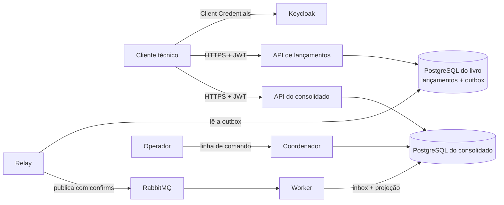

# CashFlow

Controle de fluxo de caixa diário de um comerciante: um serviço registra
lançamentos (débitos e créditos) e outro entrega o saldo diário consolidado.
Entrega do desafio de Arquiteto de Soluções descrito em
[`Desafio_Arquiteto_Soluções.md`](Desafio_Arquiteto_Solu%C3%A7%C3%B5es.md)
(DES), com os requisitos de infraestrutura de
[`Requisitos_de_Infraestrutura.md`](Requisitos_de_Infraestrutura.md) (INFRA).

O que este README cobre: como a solução funciona, onde está cada requisito
obrigatório de DES, como rodar localmente do zero, como executar os testes e
o runbook de reconstrução do consolidado. O restante da documentação fica em
[`docs/`](#documentação).

## Sumário

- [Como funciona](#como-funciona)
- [Rastreio dos requisitos de DES](#rastreio-dos-requisitos-de-des)
- [Pré-requisitos](#pré-requisitos)
- [Executar localmente](#executar-localmente)
- [Usar as APIs](#usar-as-apis)
- [Executar os testes](#executar-os-testes)
- [Runbook: reconstrução do consolidado](#runbook-reconstrução-do-consolidado)
- [Estrutura do repositório](#estrutura-do-repositório)
- [Documentação](#documentação)
- [Limitações e pendências conhecidas](#limitações-e-pendências-conhecidas)

## Como funciona

Dois serviços de negócio independentes, cada um com o seu banco PostgreSQL,
ligados por eventos (INFRA 2.1, 3.3;
[ADR-001](docs/adr/ADR-001-servicos-independentes-bancos-exclusivos.md)):

- **Lançamentos** (livro de caixa, fonte de verdade). A API grava o
  lançamento e o evento correspondente na mesma transação, numa tabela de
  saída (outbox). Lançamento registrado não é alterado nem apagado. A API não
  chama o consolidado nem o RabbitMQ, por isso continua confirmando
  lançamentos com o consolidado fora do ar, como exige DES.
- **Relay** lê a outbox e publica cada evento no RabbitMQ, com confirmação do
  broker; evento sem confirmação continua pendente e é publicado de novo
  ([ADR-003](docs/adr/ADR-003-outbox-transacional-e-relay.md),
  [ADR-004](docs/adr/ADR-004-rabbitmq-confirms-ack-apos-commit.md)).
- **Worker** consome os eventos, descarta duplicatas pela inbox, aplica a
  contribuição de cada lançamento no saldo do dia e só confirma a mensagem
  depois do commit. Evento em conflito vai para quarentena durável, nunca é
  descartado em silêncio
  ([ADR-005](docs/adr/ADR-005-inbox-deduplicacao-quarentena.md)).
- **Consolidado** (projeção do saldo diário). A API responde o saldo de uma
  data ou de um intervalo e se um lançamento já foi incluído, lendo só o seu
  próprio banco.
- **Coordenador operacional** (linha de comando, só para o operador)
  reconcilia o consolidado com o livro, reconstrói a projeção numa geração
  nova a partir do livro e troca a geração ativa sem interromper as consultas
  ([ADR-007](docs/adr/ADR-007-geracoes-barreira-troca-atomica.md)).
- **Keycloak** emite tokens por OAuth 2.0 Client Credentials; cada API valida
  o JWT e o escopo da rota por conta própria, sem gateway
  ([ADR-008](docs/adr/ADR-008-keycloak-client-credentials-jwt.md)).
- **Prometheus e Grafana** coletam e mostram as métricas de INFRA 8.3
  ([ADR-012](docs/adr/ADR-012-prometheus-grafana.md)).

Texto alternativo: o cliente técnico obtém um token no Keycloak e chama, por
HTTPS, a API de lançamentos e a API do consolidado. A API de lançamentos
grava no banco do livro. O relay lê a outbox desse banco e publica no
RabbitMQ. O worker consome do RabbitMQ e grava no banco do consolidado, que a
API do consolidado lê. O operador usa o coordenador, que só fala com o banco
do consolidado. Nenhuma seta liga o lado do consolidado ao banco do livro.



Consequência que o cliente precisa conhecer: o consolidado é eventualmente
consistente. O lançamento confirmado aparece no saldo depois que o worker o
processa; a resposta do consolidado traz `posicao_checkpoint` e a rota de
inclusão diz se um lançamento já está no saldo
([fluxos](docs/arquitetura/04-fluxos.md)).

Stack: Python 3.12, uv, FastAPI, psycopg 3, aio-pika, Alembic, pytest, k6,
Ruff, mypy, PostgreSQL, RabbitMQ, Keycloak, Prometheus e Grafana, tudo em um
Docker Compose local
([ADR-009](docs/adr/ADR-009-stack-python.md),
[ADR-010](docs/adr/ADR-010-docker-compose-local.md)).

## Rastreio dos requisitos de DES

Requisitos obrigatórios de DES e o arquivo que atende cada um (spec 006,
`design.md` §4):

| Requisito obrigatório de DES | Arquivo |
|------------------------------|---------|
| Mapeamento de domínios e capacidades | [`docs/dominios-capacidades.md`](docs/dominios-capacidades.md) |
| Refinamento de requisitos | [`docs/requisitos.md`](docs/requisitos.md) |
| Desenho da solução (arquitetura alvo) | [`docs/arquitetura/`](docs/arquitetura/README.md) |
| Justificativa de tecnologias e tipo de arquitetura | [`docs/adr/`](docs/adr/README.md) |
| Testes | [`docs/testes/`](docs/testes/estrategia.md) e pasta [`tests/`](tests/) |
| README | [`README.md`](README.md) (este arquivo) |
| Repositório público | `cashflow` no GitHub (decisão 006 D-005); publicação na etapa final (006-T8) |
| Documentação no repositório | [`docs/`](#documentação) |

"Pode ser feito na linguagem que você domina": Python 3.12
([ADR-009](docs/adr/ADR-009-stack-python.md)).

Requisitos diferenciais e requisitos não funcionais de DES:

| Item de DES | Arquivo |
|-------------|---------|
| Arquitetura de transição | [`docs/transicao.md`](docs/transicao.md): não aplicável, sem legado informado (decisão 006 D-002) |
| Estimativa de custos com infraestrutura e licenças | [`docs/custos.md`](docs/custos.md) |
| Monitoramento e observabilidade | [`docs/observabilidade.md`](docs/observabilidade.md) |
| Critérios de segurança para consumo de serviços | [`docs/seguranca.md`](docs/seguranca.md) |
| Lançamentos disponíveis com o consolidado fora | [`tests/e2e/test_independencia_lancamentos.py`](tests/e2e/test_independencia_lancamentos.py); [`docs/testes/relatorio-falhas.md`](docs/testes/relatorio-falhas.md) |
| Consolidado com 50 req/s e no máximo 5% de perda | [`docs/testes/relatorio-carga.md`](docs/testes/relatorio-carga.md) |
| Evoluções futuras (DES - Observações) | [`docs/evolucoes.md`](docs/evolucoes.md) |

## Pré-requisitos

| Item | Para quê | Observação |
|------|----------|------------|
| Linux com Docker Engine e Docker Compose v2 | Executar a solução | macOS e Windows: sem garantia, não testados |
| Git | Obter o código | |
| OpenSSL | Gerar a AC local, os certificados e os segredos | |
| `curl` e `jq` | Verificar o ambiente e chamar as APIs | |
| uv | Executar os testes | Instala o Python 3.12 do projeto, se faltar |
| k6 | Teste de carga | Só para o teste de carga |

Portas do host usadas, todas em `127.0.0.1`: 8443 (Keycloak), 8444 (API de
lançamentos), 8445 (API do consolidado) e 8446 (Grafana). Se alguma estiver
ocupada, troque pela variável correspondente em `infra/.env`
([implantação local](docs/arquitetura/05-implantacao-local.md#portas-publicadas)).

Os contêineres das APIs, do Keycloak e do Grafana rodam com UID e GID 1000 e
leem as chaves TLS geradas no host com modo 0640. Os comandos abaixo foram
verificados com um usuário de UID 1000; com outro usuário, veja
[limitações](#limitações-e-pendências-conhecidas).

## Executar localmente

Todos os comandos rodam a partir da raiz do repositório.

**1. Obter o código.**

```bash
git clone <url-do-repositório> cashflow
cd cashflow
```

**2. Gerar a AC local e os certificados TLS** (em `infra/tls/gerados/`,
ignorado pelo Git):

```bash
infra/tls/gerar-certificados.sh
```

**3. Criar `infra/.env` com segredos próprios.** O modelo
[`.env.example`](.env.example) só tem nomes e valores vazios. O comando
abaixo copia o modelo e preenche cada valor vazio com um segredo aleatório
de 48 caracteres hexadecimais:

```bash
install -m 600 /dev/null infra/.env
awk '/^[A-Z_]+=$/ { c = "openssl rand -hex 24"; c | getline s; close(c); $0 = $0 s } 1' \
  .env.example > infra/.env
```

O Compose recusa subir com qualquer variável obrigatória vazia. O arquivo
`infra/.env` nunca vai para o Git.

**4. Aplicar as migrações dos dois bancos.** Cada comando sobe o banco do
seu lado, aplica o esquema com o papel de migração e termina:

```bash
docker compose -f infra/compose.yaml run --rm --build livro-migracao
docker compose -f infra/compose.yaml run --rm --build consolidado-migracao
```

**5. Subir a solução** e esperar todos os health checks:

```bash
docker compose -f infra/compose.yaml up -d --build --wait
```

**6. Verificar a infraestrutura.** O script confere que bancos, RabbitMQ e
Keycloak estão prontos e busca o JWKS do Keycloak por TLS validado pela AC
local:

```bash
infra/verificar-ambiente.sh
```

Saída esperada na última linha: `[verificar-ambiente] resultado: tudo pronto`.

**7. Grafana** (opcional): `https://localhost:8446`, usuário
`admin-cashflow`, senha `GRAFANA_SENHA_ADMIN` de `infra/.env`, painel
"CashFlow". O navegador só aceita o certificado se confiar na AC local
`infra/tls/gerados/ac/ac-cashflow.crt`.

**Parar e limpar.**

```bash
docker compose -f infra/compose.yaml down      # para e mantém os dados
docker compose -f infra/compose.yaml down -v   # para e apaga os volumes
```

Depois de um `down -v`, repita a partir do passo 4. Os segredos de
`infra/.env` só são gravados nos bancos, no RabbitMQ, no Keycloak e no
Grafana na criação dos volumes: para trocá-los, use `down -v` ou reaplique
os scripts de papéis
([implantação local](docs/arquitetura/05-implantacao-local.md#volumes)).

## Usar as APIs

Com a solução no ar. Há dois clientes técnicos, com escopos mínimos (INFRA
5.4, 5.11;
[ADR-013](docs/adr/ADR-013-escopo-lancamentos-consultar.md)):

| Cliente | Escopos | Segredo em `infra/.env` |
|---------|---------|-------------------------|
| `cliente-lancamentos` | `lancamentos:registrar` | `KEYCLOAK_SEGREDO_CLIENTE_LANCAMENTOS` |
| `cliente-consultas` | `lancamentos:consultar`, `consolidado:consultar` | `KEYCLOAK_SEGREDO_CLIENTE_CONSULTAS` |

Obter um token de cada cliente. O token vale 300 s
([ADR-008](docs/adr/ADR-008-keycloak-client-credentials-jwt.md)):

```bash
AC=infra/tls/gerados/ac/ac-cashflow.crt

token() {
  curl -sS --cacert "$AC" \
    -d grant_type=client_credentials -d client_id="$1" \
    --data-urlencode "client_secret=$(grep "^$2=" infra/.env | cut -d= -f2-)" \
    https://localhost:8443/realms/cashflow/protocol/openid-connect/token |
    jq -r .access_token
}

TOKEN_REGISTRO=$(token cliente-lancamentos KEYCLOAK_SEGREDO_CLIENTE_LANCAMENTOS)
TOKEN_CONSULTA=$(token cliente-consultas KEYCLOAK_SEGREDO_CLIENTE_CONSULTAS)
```

Registrar um lançamento. `tipo` é `CREDITO` ou `DEBITO`; `valor` é positivo,
em reais, com até duas casas; `data_lancamento` é o dia, no formato
`AAAA-MM-DD`; `descricao` é opcional. `Idempotency-Key` é obrigatório:
repetir a chave com o mesmo corpo devolve a mesma resposta sem criar outro
lançamento, e com outro corpo devolve 409.

```bash
curl -sS --cacert "$AC" -X POST https://localhost:8444/v1/lancamentos \
  -H "Authorization: Bearer $TOKEN_REGISTRO" \
  -H "Content-Type: application/json" \
  -H "Idempotency-Key: exemplo-0001" \
  -d '{"tipo": "CREDITO", "valor": "150.00", "data_lancamento": "2026-11-09", "descricao": "Venda"}'
```

A resposta traz o `id` e a `posicao` do lançamento no livro.

Consultar:

```bash
# Lançamentos de um intervalo (paginado por limite e cursor)
curl -sS --cacert "$AC" -H "Authorization: Bearer $TOKEN_CONSULTA" \
  "https://localhost:8444/v1/lancamentos?data_inicio=2026-11-01&data_fim=2026-11-30"

# Saldo consolidado de uma data (404 se a data não tem lançamentos consolidados)
curl -sS --cacert "$AC" -H "Authorization: Bearer $TOKEN_CONSULTA" \
  https://localhost:8445/v1/consolidado/saldos/2026-11-09

# Saldos de um intervalo (omite dias sem lançamentos)
curl -sS --cacert "$AC" -H "Authorization: Bearer $TOKEN_CONSULTA" \
  "https://localhost:8445/v1/consolidado/saldos?data_inicio=2026-11-01&data_fim=2026-11-30"

# Se um lançamento já está no consolidado
curl -sS --cacert "$AC" -H "Authorization: Bearer $TOKEN_CONSULTA" \
  https://localhost:8445/v1/consolidado/inclusoes/<id-do-lançamento>
```

O saldo traz `total_creditos`, `total_debitos`, `saldo_dia`,
`saldo_acumulado` e `posicao_checkpoint`. Sem token, as APIs devolvem 401;
com token sem o escopo da rota, 403. Respostas de erro, conduta esperada do
consumidor e as demais regras de consumo: [`docs/seguranca.md`](docs/seguranca.md).

## Executar os testes

Detalhes, níveis e a última execução completa:
[`docs/testes/estrategia.md`](docs/testes/estrategia.md).

```bash
uv sync

# Unidade: sem Docker, em segundos
uv run pytest services/*/tests/unit packages/*/tests

# Suíte completa: unidade, integração, infraestrutura, observabilidade e
# falhas (cerca de 27 min; exige a solução no ar, passo 5)
uv run --env-file infra/.env pytest

# Só os cenários de falha de INFRA 9.6 (sobem projetos Compose próprios)
uv run --env-file infra/.env pytest tests/e2e

# Carga: 50 consultas/s por 300 s contra a API do consolidado (INFRA 9.4)
SSL_CERT_FILE=infra/tls/gerados/ac/ac-cashflow.crt \
  uv run --env-file infra/.env -- k6 run tests/carga/consolidado.js
```

Os testes de integração usam PostgreSQL, RabbitMQ e Keycloak reais, nunca
simulados (INFRA 9.1 a 9.3). Módulo sem a dependência necessária é pulado
com o motivo impresso; os poucos módulos que precisam de variável própria
(`KEYCLOAK_URL`, `RABBITMQ_HOST`) trazem o comando na docstring e estão
listados na estratégia.

Resultados registrados em 2026-11-09: suíte completa com 1.094 aprovados e
55 pulados, e os 55 aprovados pelos comandos próprios
([estratégia](docs/testes/estrategia.md#última-execução-da-suíte)); carga com
15.000 de 15.000 consultas com sucesso, perda 0
([relatório de carga](docs/testes/relatorio-carga.md)); os 9 cenários de
falha de INFRA 9.6 aprovados
([relatório de falhas](docs/testes/relatorio-falhas.md)).

## Runbook: reconstrução do consolidado

Quando usar: a reconciliação acusa diferença entre o consolidado e o livro,
ou o RabbitMQ perdeu mensagens (por exemplo, volume do broker perdido). O
livro e a outbox bastam para recompor o consolidado; o RabbitMQ não é
histórico (INFRA 4.11, 7.6). As consultas continuam respondendo pela geração
ativa durante todo o processo. Fundamento:
[fluxos 6 a 9](docs/arquitetura/04-fluxos.md#6-reconstrução-da-projeção) e
[ADR-007](docs/adr/ADR-007-geracoes-barreira-troca-atomica.md).

Os comandos de operação rodam sob demanda, pelo perfil `operacao` do
Compose. O lado do livro e o lado do consolidado não têm rede em comum
(INFRA 6.7): o relatório do livro passa pelo operador, por arquivo.

Construa as imagens de operação antes do primeiro uso. Se o `run` precisar
construir a imagem, a saída da construção sai junto na saída padrão e
corrompe o relatório do passo 1.

```bash
COMPOSE="docker compose -f infra/compose.yaml"
$COMPOSE --profile operacao build
```

**1. Reconciliar** (diagnóstico, não corrige nada). O relatório tem
conteúdo financeiro: fica num arquivo temporário fora do repositório.

```bash
RELATORIO=$(mktemp)
$COMPOSE run --rm -T livro-relatorio > "$RELATORIO"
$COMPOSE run --rm -T coordenador reconciliar < "$RELATORIO"
```

Código de saída 0: `resultado: conciliada`, nada a fazer. Código 3: lista as
datas divergentes e as posições faltantes; siga para o passo 2.

**2. Iniciar a reconstrução.** Cria a geração candidata; daqui em diante o
worker aplica cada evento na ativa e na candidata.

```bash
$COMPOSE run --rm coordenador reconstruir iniciar
```

Recusado se já houver uma geração `construindo` ou `anterior`: no máximo duas
gerações coexistem (INFRA 7.5). Veja o passo 6.

**3. Republicar o livro desde a posição 1** (lado do livro). Reabre os
eventos da outbox; o relay em execução os publica de novo, e a ativa os
ignora pela inbox.

```bash
$COMPOSE run --rm relay-republicar --desde-posicao 1
```

**4. Acompanhar** até a linha `critério de troca (FR-009): atendido nesta
leitura` (candidata sem lacunas e checkpoint maior ou igual ao da ativa):

```bash
$COMPOSE run --rm coordenador reconstruir status
```

**5. Trocar a geração ativa.** O coordenador ergue a barreira, espera os
workers pausarem, confere o critério com eles parados e troca o ponteiro numa
transação. Sem a pausa no tempo limite (padrão 30 s, `--tempo-limite S`), a
troca é recusada e nada muda.

```bash
$COMPOSE run --rm coordenador geracao trocar
```

Confira com uma nova reconciliação (passo 1), que deve terminar com código
0, e apague o relatório: `rm -f "$RELATORIO"`.

**6. Fechar o ciclo.**

```bash
# Se a nova ativa estiver errada: volta a anterior, com o mesmo protocolo de barreira
$COMPOSE run --rm coordenador geracao rollback

# Com a nova ativa aceita: descarta a anterior e libera a próxima reconstrução
$COMPOSE run --rm coordenador geracao descartar

# Antes da troca, para desistir: descarta a candidata
$COMPOSE run --rm coordenador reconstruir cancelar
```

Códigos de saída do coordenador: 0 sucesso, 1 operação recusada ou falha do
banco, 2 uso inválido, 3 reconciliação com divergência. A sequência completa
(perda do broker, reconciliação, reconstrução, troca e nova reconciliação) é
testada em [`tests/e2e/test_reconstrucao.py`](tests/e2e/test_reconstrucao.py).

## Estrutura do repositório

```text
services/
  lancamentos/      API de lançamentos, migrações do livro, relatório do livro
  relay/            relay da outbox e comando de republicação
  consolidado/      worker que projeta o saldo diário, API do consolidado e
                    migrações da projeção (mesma imagem, processos separados)
  coordenador/      linha de comando de reconciliação, reconstrução e gerações
packages/
  seguranca/        validação de JWT compartilhada pelas APIs
  observabilidade/  catálogo fechado de métricas e endpoint /metrics
infra/              compose, scripts de TLS e de verificação, realm do Keycloak,
                    RabbitMQ, papéis do PostgreSQL, Prometheus e Grafana
tests/              infraestrutura, observabilidade, e2e e falhas, carga (k6)
docs/               documentação de projeto
```

Cada serviço segue a arquitetura hexagonal (`dominio/`, `aplicacao/`,
`adaptadores/`) e tem os seus testes em `services/<serviço>/tests/`
([ADR-002](docs/adr/ADR-002-arquitetura-hexagonal.md),
[componentes](docs/arquitetura/03-componentes.md)).

## Documentação

| Documento | Conteúdo |
|-----------|----------|
| [`docs/dominios-capacidades.md`](docs/dominios-capacidades.md) | Domínios funcionais, capacidades de negócio, personas e glossário |
| [`docs/requisitos.md`](docs/requisitos.md) | Requisitos funcionais e não funcionais refinados, com IDs, por spec |
| [`docs/arquitetura/`](docs/arquitetura/README.md) | Arquitetura alvo: contexto, contêineres, componentes, fluxos e implantação local, com diagramas |
| [`docs/adr/`](docs/adr/README.md) | 16 registros de decisão, com alternativas e consequências |
| [`docs/observabilidade.md`](docs/observabilidade.md) | Métricas, painel, alertas, logs e health checks |
| [`docs/seguranca.md`](docs/seguranca.md) | Regras de segurança para consumo dos serviços |
| [`docs/custos.md`](docs/custos.md) | Licenças e estimativa de custo no Google Cloud |
| [`docs/transicao.md`](docs/transicao.md) | Arquitetura de transição (não aplicável) |
| [`docs/evolucoes.md`](docs/evolucoes.md) | Fora do escopo, evoluções e lacunas conhecidas |
| [`docs/testes/`](docs/testes/estrategia.md) | Estratégia de testes, relatório de carga e relatório de falhas |

O projeto foi conduzido com especificações aprovadas antes do código
(requisitos, desenho e tarefas por funcionalidade). Essas especificações
ficam numa pasta local não versionada (decisão 006 D-006); o conteúdo que o
avaliador precisa foi transcrito para `docs/`.

## Limitações e pendências conhecidas

- **Usuário com UID diferente de 1000.** As chaves TLS saem do script com
  modo 0640 e dono igual ao usuário que o executou; os contêineres que as
  leem rodam como 1000:1000. Com outro UID, ajuste o dono das chaves para
  1000 antes do passo 5 (`sudo chown 1000:1000 infra/tls/gerados/*.key`).
  `[NVI]`: não testado com outro UID.
- **macOS e Windows** não foram testados (decisão de Eduardo, 001/Q-001).
- **Lint e tipos** (Ruff e mypy) rodam como ferramentas avulsas (`uvx ruff
  check .`, `uv run --with mypy mypy`), sem script único de verificação
  ([ADR-009](docs/adr/ADR-009-stack-python.md)).
- **ADR-016** (isolamento de rede da observabilidade) está aplicado no
  código, mas com status `Proposto`, pendente de confirmação de Eduardo
  ([ADR-016](docs/adr/ADR-016-isolamento-de-rede-da-observabilidade.md)).
- **Publicação no GitHub** é a etapa final (006-T8).
- Demais lacunas e o que ficou fora do escopo:
  [`docs/evolucoes.md`](docs/evolucoes.md).
