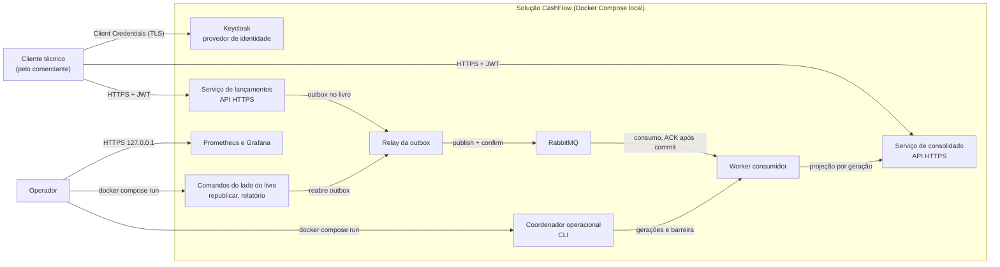

# 01 - Contexto

Visão de fora: quem usa a solução, o que ela oferece e com o que se comunica.
Índice da arquitetura: [README](README.md).

## Problema e objetivo

Um comerciante controla o fluxo de caixa diário com lançamentos de débito e
crédito e precisa de um relatório com o saldo diário consolidado (DES -
Descritivo da Solução). Duas exigências moldam a arquitetura (DES - Requisitos
não funcionais):

1. O controle de lançamentos não pode ficar indisponível se o consolidado
   diário cair.
2. Em dias de pico, o consolidado recebe 50 requisições por segundo, com no
   máximo 5% de perda.

Domínios e capacidades: [`dominios-capacidades.md`](../dominios-capacidades.md).
Requisitos refinados: [`requisitos.md`](../requisitos.md).

## Atores

| Ator | Como interage | Origem |
|------|---------------|--------|
| Comerciante | Por meio de um cliente técnico; não há interface de usuário na entrega | DES; INFRA 2.1, 2.3 (somente APIs) |
| Cliente técnico | Sistema que chama as APIs por HTTPS com token OAuth 2.0 Client Credentials. Dois clientes no realm: `cliente-lancamentos` (`lancamentos:registrar`) e `cliente-consultas` (`consolidado:consultar`, `lancamentos:consultar`) | INFRA 5.2, 5.4; escopo `lancamentos:consultar`: Eduardo (002/Q-001) |
| Operador | Executa, por linha de comando sem porta exposta, a republicação da outbox, o relatório do livro, a reconstrução, a troca e o rollback de geração e a reconciliação | INFRA 2.5, 6.4 |
| Avaliador | Lê a documentação, sobe o ambiente local e executa os testes | DES - Requisitos obrigatórios |

## Diagrama de contexto

Texto alternativo: o cliente técnico obtém um token no Keycloak e chama, por
HTTPS com o token, a API de lançamentos e a API do consolidado. A API de
lançamentos grava no livro; o relay leva os eventos do livro ao RabbitMQ; o
worker leva os eventos do RabbitMQ à projeção do consolidado, que a API do
consolidado consulta. O operador usa linhas de comando restritas, uma do lado
do livro (republicação e relatório) e outra do lado do consolidado
(coordenador). Prometheus coleta métricas e o Grafana as exibe a quem está no
host.

Base: `006/design.md` §3 (diagrama de contexto), detalhado com os comandos do
lado do livro (`003/design.md` TD-004; `005/design.md` §4) e a observabilidade
(spec 007).

## Fronteira do sistema

Dentro da entrega (INFRA §2, §3, §4, §5; spec 007):

- Serviço de lançamentos, relay da outbox, worker consumidor, serviço de
  consolidado e coordenador operacional.
- Dois PostgreSQL exclusivos, RabbitMQ, Keycloak local, Prometheus, Grafana e
  dois exporters do PostgreSQL.

Fora da entrega (INFRA - Fora do escopo atual; INFRA 5.12): Kubernetes, alta
disponibilidade produtiva, múltiplas zonas ou regiões, balanceador de carga,
API Gateway, infraestrutura em nuvem, multiempresa, disaster recovery
produtivo, autoscaling, SLA/RPO/RTO numéricos, cluster RabbitMQ, cluster
PostgreSQL, RBAC e ABAC. Também fora: interface de usuário, tracing
distribuído e notificação externa de alertas (`007/design.md` TD-004).

## Tipo de arquitetura

DES pede escolher um padrão arquitetural (microsserviços, monolitos, SOA ou
serverless) e justificar o trade-off. O desenho adotado:

| Característica | Escolha | Origem |
|----------------|---------|--------|
| Decomposição | Serviços independentes por domínio (lançamentos e consolidado), cada um com banco exclusivo, credenciais, pools e migrações próprios; sem SQL cruzado, chave estrangeira entre serviços ou transação distribuída | INFRA 2.1, 3.3; ST-TD-001 |
| Integração | Assíncrona por eventos: outbox transacional + relay + RabbitMQ; consumidor idempotente com inbox | INFRA 2.2, 2.4, §4 |
| Estilo interno | Hexagonal (portas e adaptadores): domínio sem dependência de framework, banco ou broker | INFRA 2.1 (obrigatório em lançamentos); extensão aos demais: Proposta |
| Consistência | Forte dentro do livro (uma transação por lançamento); eventual entre livro e consolidado, com sinal de inclusão e checkpoint expostos ao cliente | INFRA 2.3, 3.1, 3.2 |
| Leitura | Projeção materializada por data, versionada em gerações, reconstruível a partir do livro | INFRA 2.5, 3.2, 7.6 |
| Fonte de verdade | O livro e a outbox; o RabbitMQ não é fonte de verdade nem histórico para reconstrução | INFRA 4.11, 7.2 |
| Implantação | Docker Compose local, um nó; Kubernetes fora do escopo | INFRA 1.5 |

Consequência central: o registro de lançamento depende só do banco do livro
e do JWKS em cache. Consolidado, worker, relay e RabbitMQ podem estar parados
sem impedir a confirmação de um lançamento válido (P-001; teste
`tests/e2e/test_independencia_lancamentos.py`).

## Decisões que moldam a arquitetura

Os ADRs ficam em `docs/adr/` (task 006-T3). Origem de cada um, conforme
`006/design.md` §4:

| ADR | Título | Origem |
|-----|--------|--------|
| ADR-001 | Serviços independentes com bancos exclusivos e integração assíncrona | INFRA 2.1, 3.3; ST-TD-001 |
| ADR-002 | Arquitetura hexagonal | INFRA 2.1 |
| ADR-003 | Outbox transacional e relay | INFRA 2.2, 3.1; 002 TD-001; 003 TD-001 a TD-004 |
| ADR-004 | RabbitMQ com confirms, `mandatory` e ACK após commit; não é fonte de verdade | INFRA §4; 004 TD-002 |
| ADR-005 | Inbox, deduplicação e quarentena | INFRA 2.4; 004 TD-001, TD-003 |
| ADR-006 | Posição monotônica e checkpoint | 002 TD-002; 004 TD-006 |
| ADR-007 | Gerações da projeção, barreira e troca atômica | INFRA 2.5; 005 TD-001 a TD-003 |
| ADR-008 | Keycloak, Client Credentials, JWT validado em cada API, sem gateway/RBAC/ABAC | INFRA §5 |
| ADR-009 | Python 3.12, uv, FastAPI, psycopg 3, aio-pika, Alembic, pytest, k6, Ruff, mypy | INFRA 1.3; ST-TD-007 |
| ADR-010 | Docker Compose local; Kubernetes fora do escopo | INFRA 1.5; Fora do escopo |
| ADR-011 | Sem cache na entrega inicial | 004 TD-005 |
| ADR-012 | Prometheus + Grafana | ST-TD-008; spec 007 |
| ADR-013 | Escopo adicional `lancamentos:consultar` | 002 D-002 |
| ADR-014 | Audiência do token derivada do escopo | 001 TD-008; 002 DQ-003 |
| ADR-015 | Catálogo fechado de métricas e métricas do projeto fora de INFRA 8.3 | 007 TD-003, TD-005, TD-006 |
| ADR-016 | Isolamento de rede da observabilidade e bind do `/metrics` | 007 TD-007; 001 TD-002 |
