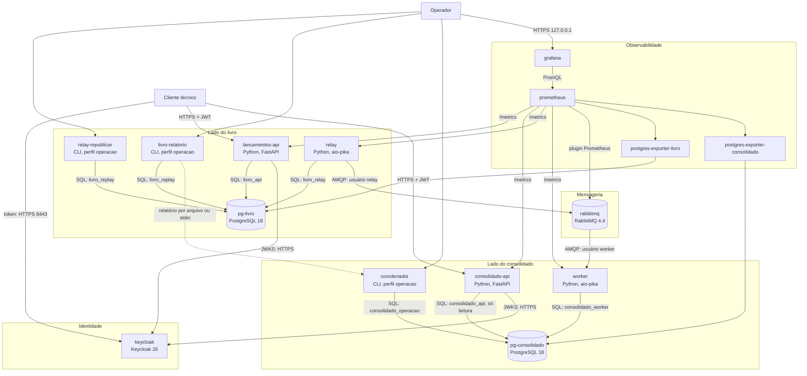

# 02 - Contêineres

Aqui listo os processos executáveis e os armazenamentos da solução, com a
tecnologia que escolhi para cada um e quem fala com quem. Cada item
corresponde a um serviço de [`infra/compose.yaml`](../../infra/compose.yaml).
Detalho redes, portas e volumes em [05 - Implantação local](05-implantacao-local.md).
Índice: [README](README.md).

## Diagrama de contêineres

Texto alternativo: do lado do livro, a API de lançamentos (FastAPI) grava no
PostgreSQL do livro; o relay lê a outbox desse banco e publica no RabbitMQ.
Do lado do consolidado, o worker consome do RabbitMQ e grava no PostgreSQL do
consolidado; a API do consolidado só lê esse banco; o coordenador o opera. As
duas APIs buscam o JWKS no Keycloak. Os comandos de republicação e de
relatório rodam do lado do livro; o relatório chega ao coordenador por
arquivo ou entrada padrão, não por rede. O Prometheus coleta as métricas de
APIs, relay, worker, RabbitMQ e exporters; o Grafana lê o Prometheus. Não
desenhei nenhuma seta do lado do consolidado até o banco do livro, porque
essa ligação não existe (INFRA 6.7).

## Catálogo

| Contêiner | Tecnologia | Responsabilidade | Execução | Spec |
|-----------|-----------|------------------|----------|------|
| `lancamentos-api` | Python 3.12, FastAPI, psycopg 3 | Registrar lançamento (idempotente) e listar por intervalo de datas; valida JWT | Serviço contínuo | 002 |
| `relay` | Python 3.12, aio-pika, psycopg 3 | Reservar eventos pendentes da outbox com lease, publicar com `mandatory` e publisher confirms, marcar o confirmado, reagendar a falha | Serviço contínuo | 003 |
| `relay-republicar` | Imagem do relay | Reabrir eventos da outbox a partir de uma posição (`--desde-posicao N`) para o relay republicar | Sob demanda, perfil `operacao` | 003, 005 |
| `livro-relatorio` | Imagem de lançamentos | Exportar totais por data do livro até uma posição (`--ate-posicao P`), para a reconciliação | Sob demanda, perfil `operacao` | 005 |
| `livro-migracao` | Alembic | Aplicar o esquema do livro com o papel de DDL | Sob demanda, perfil `migracao` | 002 |
| `pg-livro` | PostgreSQL 18.6 | Livro: lançamentos imutáveis, contador de posição, respostas idempotentes, outbox | Serviço contínuo | 001, 002 |
| `rabbitmq` | RabbitMQ 4.4.0 (management) | Exchange `cashflow.lancamentos` e fila `consolidado.lancamentos` duráveis, mensagens persistentes | Serviço contínuo | 001, 003 |
| `worker` | Python 3.12, aio-pika, psycopg 3 | Consumir com ACK manual após commit; deduplicar; projetar em todas as gerações receptoras; quarentena; checkpoint e lacunas; respeitar a barreira | Serviço contínuo | 004, 005 |
| `consolidado-api` | Python 3.12, FastAPI, psycopg 3 | Saldo por data e por intervalo e sinal de inclusão, só da geração ativa; valida JWT; expõe a fase da reconstrução como métrica | Serviço contínuo | 004, 005 |
| `coordenador` | Python 3.12, psycopg 3 | Iniciar, acompanhar e cancelar reconstrução; trocar, desfazer e descartar geração; reconciliar | Sob demanda, perfil `operacao` | 005 |
| `consolidado-migracao` | Alembic | Aplicar o esquema do consolidado e criar a geração inicial ativa | Sob demanda, perfil `migracao` | 004, 005 |
| `pg-consolidado` | PostgreSQL 18.6 | Projeção: inbox, contribuições, saldos, marcadores, gerações, checkpoints, lacunas, controle, quarentena | Serviço contínuo | 001, 004, 005 |
| `keycloak` | Keycloak 26.8.2 | Realm `cashflow`, clientes técnicos, escopos com audiência, JWKS | Serviço contínuo | 001 |
| `prometheus` | Prometheus 3.16.0 | Coleta e regras de alerta; sem porta publicada | Serviço contínuo | 007 |
| `grafana` | Grafana OSS 13.3.0 | Painel "CashFlow" e fonte de dados provisionados | Serviço contínuo | 007 |
| `postgres-exporter-livro`, `postgres-exporter-consolidado` | postgres_exporter 0.20.1 | Métricas dos bancos, inclusive tamanho | Serviço contínuo | 007 |

Fixei as versões com fonte e data em comentário no compose (001 TD-007),
para que o avaliador suba o mesmo ambiente que testei.

## Comunicação permitida

Dei a cada ligação a credencial de menor privilégio que a sua função exige
(INFRA 5.11; P-007):

| De | Para | Protocolo | Credencial | Observação |
|----|------|-----------|------------|------------|
| Cliente técnico | `keycloak` | HTTPS (token endpoint) | `client_id` e segredo do cliente | Client Credentials (INFRA 5.2) |
| Cliente técnico | `lancamentos-api`, `consolidado-api` | HTTPS | JWT RS256 | Publicadas em `127.0.0.1` (INFRA 6.5, 6.6) |
| `lancamentos-api`, `consolidado-api` | `keycloak` | HTTPS (JWKS) | nenhuma | Cache com TTL de 300 s (INFRA 5.6) |
| `lancamentos-api` | `pg-livro` | PostgreSQL | `livro_api` (SELECT e INSERT; sem UPDATE/DELETE em `lancamento`) | 002 TD-003 |
| `relay` | `pg-livro` | PostgreSQL | `livro_relay` (lê outbox e atualiza metadados de publicação) | 003 §6 |
| `relay` | `rabbitmq` | AMQP 0-9-1 | usuário `relay`: só escrita em `cashflow.lancamentos` | INFRA 5.11 |
| `worker` | `rabbitmq` | AMQP 0-9-1 | usuário `worker`: só leitura de `consolidado.lancamentos` | INFRA 5.11 |
| `worker` | `pg-consolidado` | PostgreSQL | `consolidado_worker` | 004 §5 |
| `consolidado-api` | `pg-consolidado` | PostgreSQL | `consolidado_api`, somente leitura | 004 §6 |
| `coordenador` | `pg-consolidado` | PostgreSQL | `consolidado_operacao` | 005 §5 |
| `relay-republicar`, `livro-relatorio` | `pg-livro` | PostgreSQL | `livro_replay` | 003 TD-004; 005 §4 |
| `prometheus` | alvos de coleta | HTTP nas redes internas | nenhuma | Alvos em [`prometheus.yml`](../../infra/observabilidade/prometheus.yml) |
| `grafana` | `prometheus` | HTTP na rede de observabilidade | nenhuma | 007 TD-007 |

Caminhos que deixei de fora de propósito:

- `lancamentos-api` não chama RabbitMQ nem o consolidado (INFRA 2.1), para
  que o registro não dependa deles.
- Nenhum contêiner do lado do consolidado (`worker`, `consolidado-api`,
  `coordenador`) tem rede em comum com `pg-livro` (INFRA 6.7). Por isso o
  replay passa pela outbox e pelo RabbitMQ, e o relatório do livro passa pelo
  operador.
- O host não alcança bancos, RabbitMQ, Prometheus nem o `/metrics` dos
  serviços (INFRA 6.1 a 6.3; 007 TD-007). Verifiquei em:
  [`tests/infra/test_isolamento.py`](../../tests/infra/test_isolamento.py).

## Topologia do RabbitMQ

Declarei a topologia num arquivo de definições carregado na subida, para que
o relay não precise de permissão de configuração (`003/design.md` §4;
INFRA 5.11). Versionei o modelo em
[`infra/rabbitmq/definicoes.modelo.json`](../../infra/rabbitmq/definicoes.modelo.json),
sem senhas: o [`entrypoint.sh`](../../infra/rabbitmq/entrypoint.sh) as
preenche a partir de `infra/.env`.

| Item | Valor | Origem |
|------|-------|--------|
| Exchange | `cashflow.lancamentos`, `direct`, durável | Fonte: durável (INFRA 4.3); nome: Proposta |
| Fila | `consolidado.lancamentos`, clássica, durável | Fonte: durável (INFRA 4.4); nome: Proposta |
| Routing key | `lancamento.registrado.v1` | Proposta |
| Mensagem | persistente (`delivery_mode` 2); `message_id` = `evento_id` | Fonte: persistente (INFRA 4.5) |
| Publicação | `mandatory` e publisher confirms | INFRA 4.6, 4.7 |
| Consumo | ACK manual após o commit; `prefetch` configurável (`WORKER_PREFETCH`, padrão 10) | INFRA 4.8; 004 DQ-003 |
| Quarentena | No banco do consolidado, não em fila, para gravá-la na mesma transação da projeção | INFRA 3.2, 4.9; 004 D-008 |
