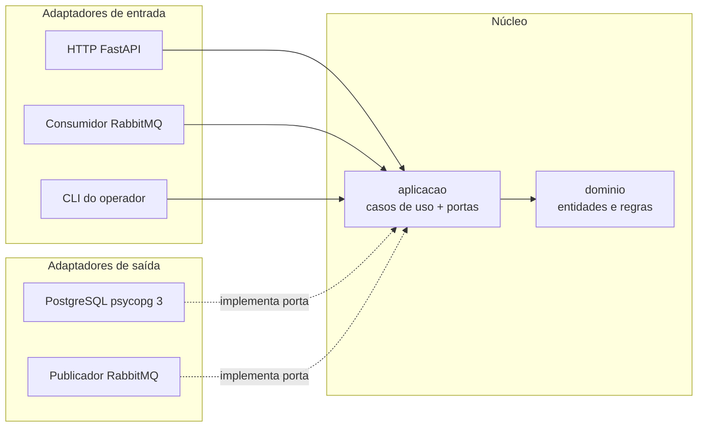
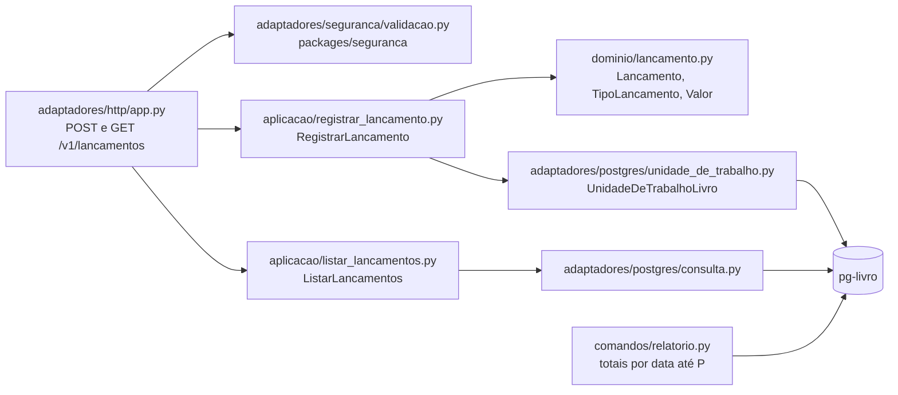
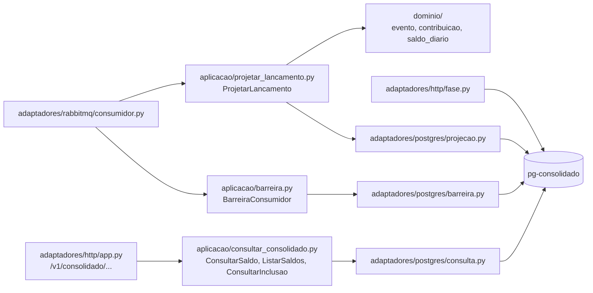
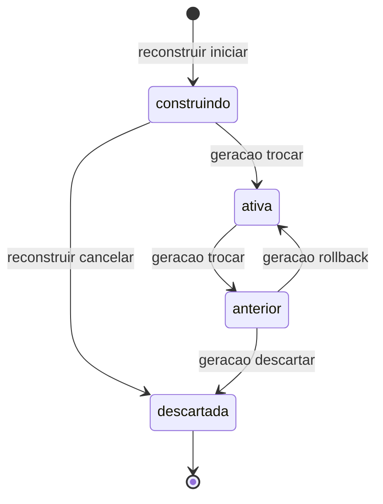

# 03 - Componentes

Estrutura interna de cada serviço, modelos de dados e pacotes compartilhados.
Índice: [README](README.md).

## Padrão comum: portas e adaptadores

INFRA 2.1 exige domínio e aplicação hexagonais no serviço de lançamentos; a
extensão do padrão aos demais componentes é Proposta aprovada
(`.ai/steering/conventions.md`). Em todos os serviços:

- `dominio/`: regras de negócio só com a biblioteca padrão do Python, sem
  framework, banco ou broker.
- `aplicacao/`: casos de uso e as portas (`typing.Protocol`) de que eles
  precisam.
- `adaptadores/`: implementações das portas (HTTP com FastAPI, PostgreSQL com
  psycopg 3, RabbitMQ com aio-pika, validação JWT) e a montagem do processo.
- `migracoes/`: Alembic com SQL explícito, uma árvore por banco (INFRA 3.3).

Texto alternativo: a dependência aponta sempre para dentro. Adaptadores de
entrada (HTTP, consumidor RabbitMQ, CLI) chamam casos de uso da aplicação;
os casos de uso usam o domínio e chamam portas; adaptadores de saída
(PostgreSQL, publicador RabbitMQ) implementam as portas.



## Serviço de lançamentos (`services/lancamentos/`)

Spec 002. Processo `lancamentos-api`; comando `livro-relatorio`.

Texto alternativo: a rota HTTP passa o token ao validador JWT do pacote de
segurança e o comando ao caso de uso `RegistrarLancamento`, que valida o
`Lancamento` no domínio e chama a porta `UnidadeDeTrabalhoLivro`. O
adaptador PostgreSQL implementa a porta numa transação sobre as quatro
tabelas do livro. A listagem segue o mesmo caminho pelo caso de uso
`ListarLancamentos` e pela consulta PostgreSQL.



| Componente | Responsabilidade | Origem |
|------------|------------------|--------|
| `dominio/lancamento.py` | Tipo (`DEBITO`, `CREDITO`), valor positivo com duas casas, data do lançamento, descrição opcional | 002 FR-002, D-001, D-004 |
| `aplicacao/registrar_lancamento.py` | Valida o comando, calcula o hash da requisição e delega a transação à porta `UnidadeDeTrabalhoLivro` | 002 TD-001, TD-004 |
| `aplicacao/listar_lancamentos.py` | Listagem por intervalo de datas com cursor | 002 TD-006 |
| `adaptadores/postgres/unidade_de_trabalho.py` | Uma transação: resposta idempotente, posição, lançamento e evento na outbox | 002 TD-001, TD-002 |
| `adaptadores/http/` | Rotas, mapeamento de erros, health e sonda do health check | 002 §4 |
| `adaptadores/seguranca/validacao.py` | Liga o validador de `packages/seguranca` às rotas, com o escopo exigido por rota | 002 TD-005 |
| `comandos/relatorio.py` | Relatório de totais por data até uma posição, para a reconciliação | 005 D-002 |

### Modelo de dados do livro

Fonte da verdade: [migração 0001](../../services/lancamentos/migracoes/versions/0001_tabelas_do_livro.py)
e seguintes.

| Tabela | Conteúdo | Regras |
|--------|----------|--------|
| `lancamento` | `id` (UUID), `posicao` única, `tipo`, `valor` `numeric(14,2)` > 0, `data_lancamento`, `descricao`, `cliente_id`, `registrado_em` | Imutável: `livro_api` só tem SELECT e INSERT (002 TD-003; INFRA 3.1) |
| `contador_posicao` | Linha única com a última posição | Bloqueada e incrementada na transação; posição sem lacunas (002 TD-002) |
| `resposta_idempotente` | PK (`cliente_id`, `chave`), hash da requisição, status e corpo | Repetição idêntica devolve a resposta original; corpo divergente, 409 (002 TD-004, D-006) |
| `outbox` | `evento_id`, `lancamento_id`, `posicao`, `tipo_evento`, `payload`, metadados de publicação (`publicado_em`, `tentativas`, `proxima_tentativa_em`, lease) | Preservada após a publicação, para replay (INFRA 7.2) |

### Contrato do evento `LancamentoRegistrado` v1

Gravado na outbox pela mesma transação do lançamento e publicado pelo relay
(`002/design.md` §4). O valor vai como texto com duas casas; descrição e
cliente não saem do livro.

```json
{
  "evento_id": "uuid",
  "versao": 1,
  "lancamento_id": "uuid",
  "posicao": 123,
  "tipo": "DEBITO|CREDITO",
  "valor": "100.00",
  "data_lancamento": "AAAA-MM-DD",
  "registrado_em": "timestamp ISO 8601"
}
```

Mudança incompatível exige versão nova do evento e da routing key
(`lancamento.registrado.v1`).

## Relay da outbox (`services/relay/`)

Spec 003. Processo `relay`; comando `relay-republicar`.

| Componente | Responsabilidade | Origem |
|------------|------------------|--------|
| `aplicacao/publicar_pendentes.py` | Ciclo: reservar lote, publicar cada evento, marcar só o confirmado sem devolução, reagendar o resto e liberar o lease | 003 §3; INFRA 2.2 |
| `aplicacao/retentativa.py` | Espera exponencial `base * 2^n` com teto, tentativas sem limite, sem descarte | 003 TD-003, D-002 |
| `adaptadores/postgres/reserva.py` | `FOR UPDATE SKIP LOCKED` com `lease_dono` e `lease_ate`; commit antes de publicar | 003 TD-001 |
| `adaptadores/postgres/marcacao.py` | Grava `publicado_em` ou reagenda (`tentativas`, `proxima_tentativa_em`) | 003 §3 |
| `adaptadores/postgres/medicao.py` | Backlog e idade do evento mais antigo, para as métricas | 003 §12 |
| `adaptadores/rabbitmq/publicador.py` | Canal com publisher confirms, `mandatory`, mensagem persistente, `message_id` = `evento_id`; distingue confirmado, devolvido, recusado, sem confirmação e falha | 003 TD-002; 007 TD-006 |
| `adaptadores/http/` | Health live e ready (banco e RabbitMQ) | INFRA 8.4, 8.5 |
| `comandos/republicar.py` | `--desde-posicao N`: zera `publicado_em` e `tentativas` dos eventos com `posicao >= N` | 003 TD-004; INFRA 7.6 |

## Serviço de consolidado (`services/consolidado/`)

Specs 004 e 005. Um pacote, dois processos: `worker`
(`consolidado/worker/`) e `consolidado-api` (`consolidado/adaptadores/http/`),
na mesma imagem com comandos diferentes (`004/design.md` §4, Proposta).

Texto alternativo: o consumidor RabbitMQ entrega cada mensagem ao caso de
uso `ProjetarLancamento`, que verifica a barreira, lê as gerações receptoras
e, para cada uma, aplica inbox, contribuição, saldo, marcador e checkpoint
pela porta de projeção. A API HTTP chama as consultas, que leem só a geração
ativa. Um vigia periódico lê a fase da reconstrução para a métrica.



| Componente | Responsabilidade | Origem |
|------------|------------------|--------|
| `dominio/evento.py` | Leitura e validação do evento v1; mensagem ilegível vira quarentena | 004 §8 |
| `dominio/contribuicao.py`, `dominio/saldo_diario.py` | Efeito de crédito e débito no saldo do dia; detecção de conflito por hash | 004 TD-001, TD-004 |
| `aplicacao/projetar_lancamento.py` | Transação por mensagem: barreira, gerações receptoras, inbox, contribuição, saldo, marcador, checkpoint e lacuna, ou quarentena | 004 §3; 005 TD-001 |
| `aplicacao/barreira.py` | Sem processar com a barreira erguida; confirma a pausa em `estado_consumidor` com o consumo fechado | 005 TD-002 |
| `adaptadores/rabbitmq/consumidor.py` | ACK manual só após o commit; reconexão; `prefetch` configurável | 004 TD-002; INFRA 4.8 |
| `aplicacao/consultar_consolidado.py` | Saldo da data (com acumulado e checkpoint), saldos do intervalo paginados por data, sinal de inclusão; sempre na geração ativa | 004 FR-004 a FR-007, TD-007, TD-008 |
| `adaptadores/http/` | Rotas, JWT com `consolidado:consultar`, health, métrica de fase | 004 §4; 005 §12 |
| `worker/` | Montagem do processo do worker, health e métricas de reentrega, quarentena, checkpoint e lacunas | 004 §12 |

### Modelo de dados do consolidado

Fonte da verdade: [migração 0001](../../services/consolidado/migracoes/versions/0001_tabelas_do_consolidado.py)
e [migração 0002](../../services/consolidado/migracoes/versions/0002_controle_de_geracoes.py).
As tabelas da projeção são chaveadas por geração, porque o replay republica o
mesmo `evento_id` e cada geração precisa deduplicar o seu (`004/design.md`
§4).

| Tabela | Conteúdo | Regras |
|--------|----------|--------|
| `geracao` | `id`, `estado`, `criada_em`, `ativada_em` | Estados e transições impostos por gatilho; uma só ativa; no máximo uma entre `construindo` e `anterior` (INFRA 7.5) |
| `controle_projecao` | Linha única: `geracao_ativa_id`, `barreira` (`liberada`/`solicitada`), `versao` | Ponteiro lido pela API a cada consulta (005 TD-003) |
| `inbox` | PK (`geracao_id`, `evento_id`), hash | Deduplicação por evento (INFRA 2.4) |
| `contribuicao` | PK (`geracao_id`, `lancamento_id`), posição, data, tipo, valor, hash | Deduplicação por lançamento; conteúdo divergente vai para quarentena |
| `saldo_diario` | PK (`geracao_id`, `data`), créditos, débitos, `saldo_dia` | `saldo_dia = total_creditos - total_debitos` por CHECK (004 TD-004) |
| `marcador_inclusao` | PK (`geracao_id`, `lancamento_id`), posição | Sinal de inclusão (INFRA 2.3) |
| `checkpoint` | PK `geracao_id`, `posicao_continua` | Maior posição sem lacuna (004 TD-006) |
| `lacuna` | (`geracao_id`, `posicao`) | Posições ausentes abaixo da maior recebida |
| `quarentena` | `evento_id`, `motivo`, `payload_bruto` | Conflito ou mensagem ilegível; nada é descartado (INFRA 4.9, 4.10) |
| `estado_consumidor` | `consumidor_id`, `pausado`, `visto_em` | Confirmação da barreira (005 §4) |
| `fase_reconstrucao` | `geracao_id`, `fase` | Métrica de fase (INFRA 8.3) |

### Estados da geração

Texto alternativo: uma geração nasce `construindo`. Pela troca, a candidata
vira `ativa` e a ativa vira `anterior`; pelo rollback, a `anterior` volta a
`ativa`. `construindo` pode ser cancelada e `anterior` pode ser descartada,
ambas indo para `descartada`, estado final. A migração inicial cria a
primeira geração já ativa.



Gerações receptoras de eventos: `ativa`, `construindo` e `anterior`
(`005/design.md` §3). As transições valem para qualquer papel, porque o
gatilho `geracao_transicao_valida` as impõe no banco.

## Coordenador operacional (`services/coordenador/`)

Spec 005. CLI sem porta (INFRA 6.4), executado pelo operador com o papel
`consolidado_operacao`.

| Comando | Caso de uso | Efeito |
|---------|-------------|--------|
| `reconstruir iniciar` | `aplicacao/reconstrucao.py` | Cria a candidata (`construindo`) com checkpoint 0 |
| `reconstruir status [--json]` | idem | Checkpoint, lacunas e fase de cada geração e o critério de troca |
| `reconstruir cancelar` | idem | Descarta a candidata e libera o espaço |
| `geracao trocar [--tempo-limite S]` | `aplicacao/geracoes.py` | Barreira, critério, troca atômica do ponteiro, libera a barreira |
| `geracao rollback [--tempo-limite S]` | idem | Mesmo protocolo; a `anterior` volta a ativa |
| `geracao descartar` | idem | Descarta a `anterior` |
| `reconciliar [--relatorio-livro ARQ]` | `aplicacao/reconciliacao.py` | Compara a ativa com o relatório do livro; relatório sem correção automática (005 D-004) |

Critério de troca (`dominio/criterio.py`; 005 FR-009): candidata sem lacunas
e com checkpoint maior ou igual ao da ativa, avaliado com os consumidores em
pausa.

## Pacotes compartilhados (`packages/`)

| Pacote | Responsabilidade | Origem |
|--------|------------------|--------|
| `packages/seguranca` | Validação JWT: cache de JWKS com TTL, algoritmo RS256, assinatura, `exp`, `iat`, emissor, audiência e escopo; erros tipados para 401, 403 e 503 | 002 TD-005, DQ-003; 004 DQ-002; 001 TD-008 |
| `packages/observabilidade` | Catálogo fechado de métricas com rótulos permitidos e servidor `/metrics` em porta interna | 007 TD-002, TD-003 |

Ambos são membros do workspace uv da raiz
([`pyproject.toml`](../../pyproject.toml)) e dependem só de bibliotecas
externas, nunca de um serviço.
