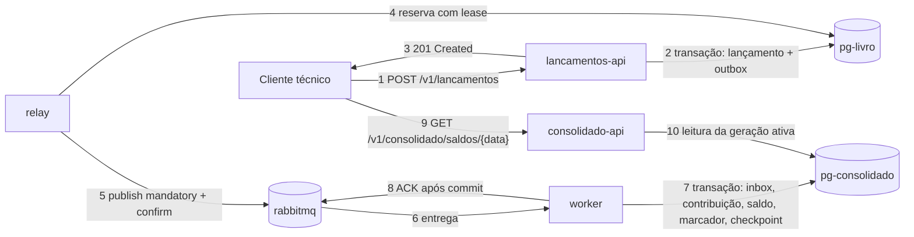
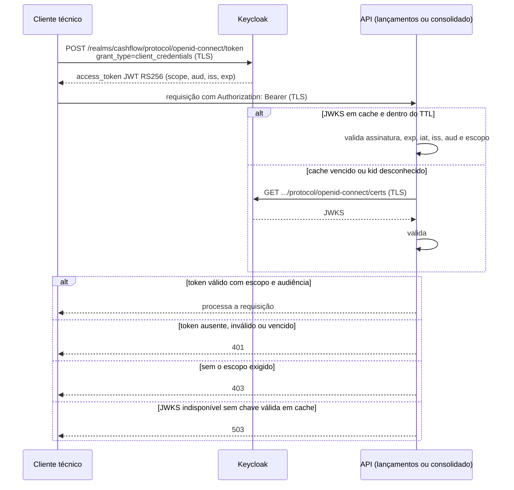
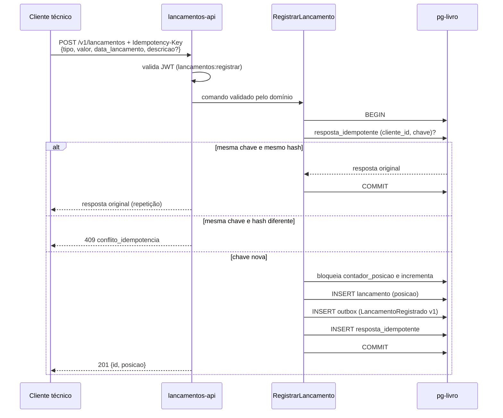
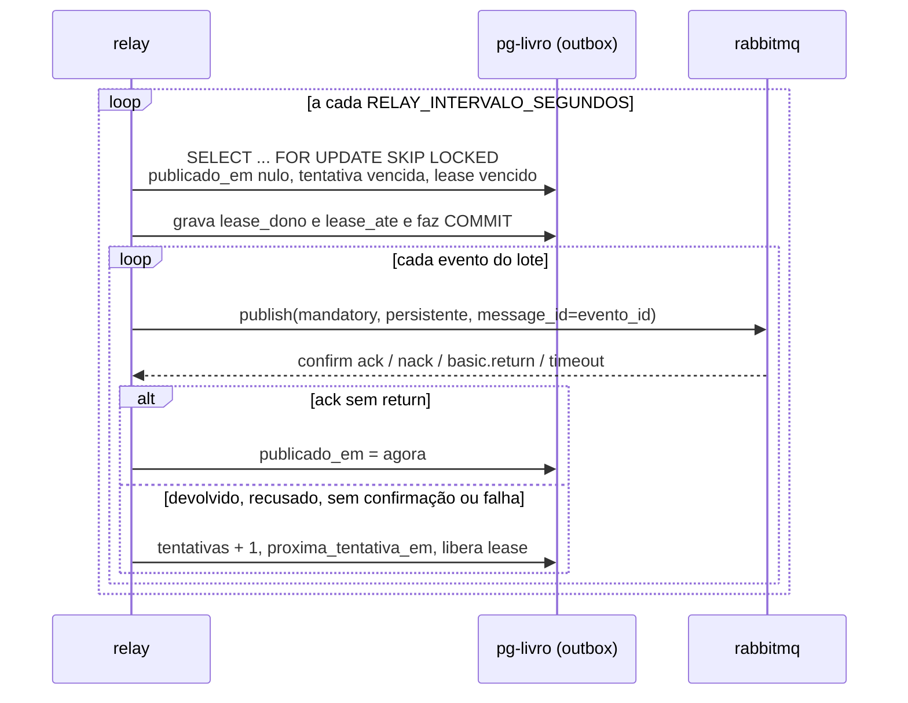
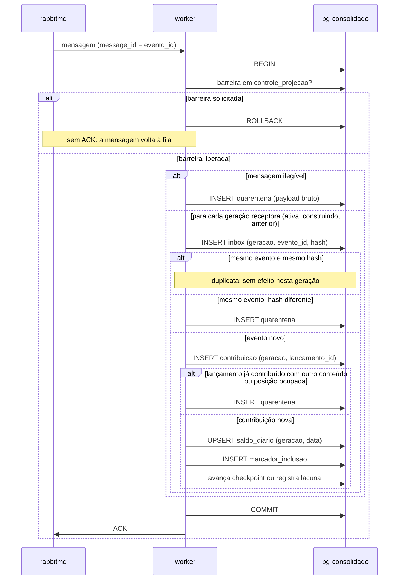
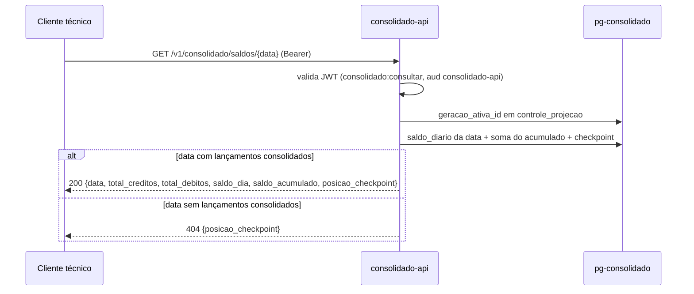
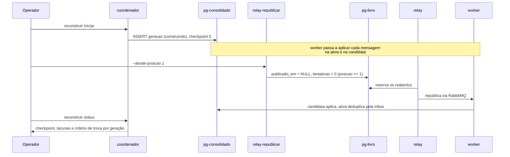
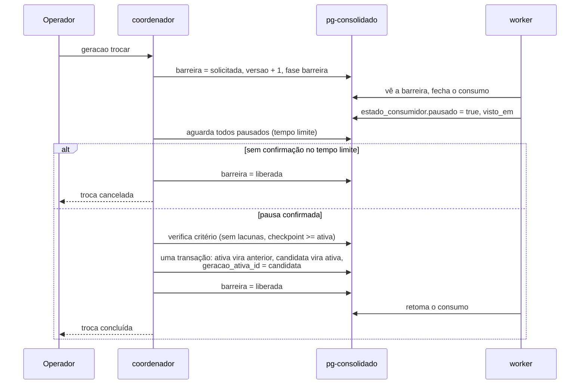
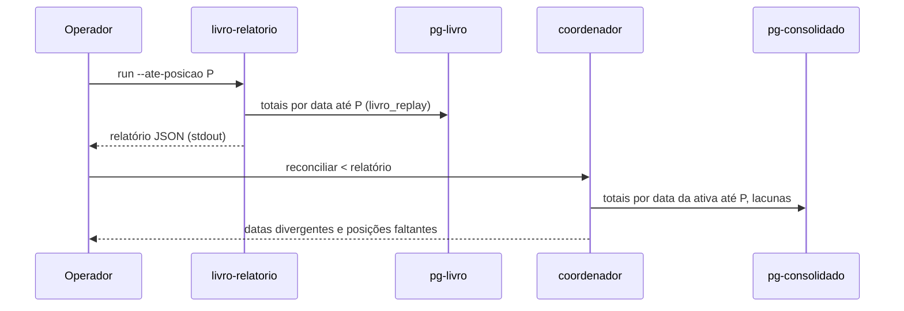

# 04 - Fluxos de dados

Aqui descrevo o caminho de um lançamento do registro até o saldo consolidado
e os fluxos de operação da projeção. Índice: [README](README.md).

| Fluxo | Seção |
|-------|-------|
| Obter token e chamar uma API | [1](#1-autenticação-e-autorização) |
| Registrar lançamento | [2](#2-registro-de-lançamento) |
| Publicar eventos da outbox | [3](#3-publicação-pelo-relay) |
| Consolidar no saldo diário | [4](#4-consolidação-pelo-worker) |
| Consultar saldo e inclusão | [5](#5-consulta-do-consolidado) |
| Reconstruir a projeção | [6](#6-reconstrução-da-projeção) |
| Trocar a geração ativa e desfazer | [7](#7-troca-e-rollback-de-geração) |
| Reconciliar livro e consolidado | [8](#8-reconciliação) |
| Recuperar após perda do RabbitMQ | [9](#9-recuperação-após-perda-do-rabbitmq) |

## Visão ponta a ponta

Texto alternativo: o lançamento entra pela API de lançamentos e é gravado,
junto com o evento, no banco do livro. O relay lê o evento da outbox e o
publica no RabbitMQ. O worker consome, grava a contribuição e o saldo no
banco do consolidado e só então confirma a mensagem. A API do consolidado lê
o saldo da geração ativa. O registro termina antes da publicação: o cliente
recebe 201 mesmo que relay, RabbitMQ, worker ou consolidado estejam parados.

Escolhi consistência forte no livro e eventual no consolidado, em troca da
independência do registro. Para compensar, dei ao cliente dois sinais: o
sinal de inclusão e o `posicao_checkpoint` devolvido em toda consulta de
saldo, que dizem se um lançamento já entrou no saldo (INFRA 2.3;
`004/design.md` §4).

## 1. Autenticação e autorização

Texto alternativo: o cliente técnico pede um token ao Keycloak com
`client_id` e segredo. O Keycloak devolve um JWT assinado com RS256 contendo
os escopos do cliente e a audiência derivada de cada escopo. O cliente chama
a API com o token. A API valida o token localmente com a chave pública obtida
do JWKS, que fica em cache; só busca o JWKS de novo quando o cache vence ou
chega um `kid` desconhecido. Sem chave válida e com o Keycloak fora, a API
responde 503.

| API | Escopo exigido | Audiência exigida | Origem |
|-----|----------------|-------------------|--------|
| `POST /v1/lancamentos` | `lancamentos:registrar` | `lancamentos-api` | INFRA 5.4; 001 TD-008 |
| `GET /v1/lancamentos` | `lancamentos:consultar` | `lancamentos-api` | Decisão minha (002/Q-001); 001 TD-008 |
| `GET /v1/consolidado/...` | `consolidado:consultar` | `consolidado-api` | INFRA 5.4; 001 TD-008 |

O Keycloak publica o emissor `https://localhost:8443/realms/cashflow` (o
endereço que o cliente usa pelo host) e as APIs buscam o JWKS pelo nome
interno `keycloak`, que incluí no certificado para que a validação TLS aceite
o nome interno. TTL do cache: 300 s (`JWT_JWKS_TTL_SEGUNDOS`; INFRA 5.6).

## 2. Registro de lançamento

Spec 002. Gravo tudo ou nada numa transação local no banco do livro; não
deixei a API falar com o RabbitMQ nem com o consolidado (INFRA 2.1, 3.1,
3.3), para que o registro não dependa deles.

Texto alternativo: a API recebe o lançamento com a chave de idempotência,
valida o token e o domínio, e abre a transação. Se a chave já existe para o
cliente com o mesmo conteúdo, devolve a resposta original; com conteúdo
diferente, 409. Se é nova, bloqueia o contador, obtém a próxima posição,
insere lançamento, evento na outbox e resposta idempotente, e confirma. Duas
requisições simultâneas com a mesma chave resolvem-se pela chave primária da
resposta idempotente: uma grava, a outra devolve a resposta da primeira.

Erros: 400/422 validação; 401; 403; 409; 503 com banco indisponível
(`002/design.md` §4). Tiro a posição de uma linha bloqueada, não de uma
sequence, para não ter lacunas em rollback: assim, lacuna no consolidado
significa evento faltante (002 TD-002).

## 3. Publicação pelo relay

Spec 003. Aceitei entrega pelo menos uma vez e resolvo as duplicatas no
consumidor, porque garantir exatamente uma vez exigiria transação entre banco
e broker, que INFRA 3.3 proíbe.

Texto alternativo: a cada intervalo, o relay reserva um lote de eventos
pendentes com lease, usando `SKIP LOCKED`, e confirma a reserva. Fora da
transação, publica cada evento com `mandatory` e espera o confirm. Com
confirmação positiva e sem devolução, grava `publicado_em`. Com devolução
(fila ausente), recusa, falta de confirmação no prazo ou erro de conexão,
incrementa `tentativas`, agenda a próxima tentativa com espera exponencial e
libera o lease. Nenhum evento sai da outbox.

Parâmetros por variável de ambiente (`003/design.md` §17): intervalo, lote
(100), lease (30 s), prazo do confirm (5 s), espera base (1 s) e teto (60 s).
Antes de cada evento do lote, o relay confere se o lease restante comporta
uma publicação inteira com 2 s de margem; se não, para o lote e deixa os
restantes voltarem à reserva quando o lease vencer. Fiz isso para que duas
execuções nunca publiquem o mesmo evento ao mesmo tempo (003 TD-005;
[ADR-003](../adr/ADR-003-outbox-transacional-e-relay.md)).
Com o RabbitMQ fora, o backlog e a idade do evento mais antigo crescem e
voltam a zero quando ele retorna (teste
[`tests/e2e/test_queda_rabbitmq.py`](../../tests/e2e/test_queda_rabbitmq.py)).

## 4. Consolidação pelo worker

Specs 004 e 005. Envio o ACK só após o commit (INFRA 4.8), para que a queda
do worker no meio da transação faça o broker reentregar, e não perder, a
mensagem. Nada é descartado sem registro (INFRA 4.10).

Texto alternativo: o worker recebe a mensagem e abre a transação. Primeiro
lê a barreira: se erguida, desfaz e não confirma, e a mensagem volta à fila.
Depois, para cada geração receptora, insere na inbox; evento repetido com o
mesmo conteúdo é ignorado, com conteúdo diferente vai para a quarentena.
Evento novo insere a contribuição do lançamento; lançamento já contribuído
com conteúdo diferente, ou outro lançamento na mesma posição, vai para a
quarentena. Caso contrário, atualiza o saldo do dia, grava o marcador de
inclusão e avança o checkpoint ou registra lacunas. Mensagem ilegível vai
para a quarentena com o conteúdo bruto. A quarentena é gravada uma vez por
mensagem, não por geração. Só depois do commit o worker envia o ACK. Se esse
ACK se perder, a reentrega grava outra linha na quarentena (lacuna conhecida,
sem efeito no saldo).

Checkpoint: maior posição contínua recebida. Aplico o evento fora de ordem e
registro as lacunas até as posições faltantes chegarem (004 TD-006), porque
a ordem de entrega não é garantida (003 D-003).
Testei queda do consolidado, queda do consumidor, perda de ACK, duplicação,
RabbitMQ indisponível e Keycloak indisponível sobre o compose real:
[`tests/e2e/test_falhas_consolidado.py`](../../tests/e2e/test_falhas_consolidado.py).
Cobri conflito e mensagem ilegível nos testes de integração do worker, em
`services/consolidado/tests/`.

## 5. Consulta do consolidado

Spec 004. A API lê somente a geração ativa (INFRA 2.3), com um papel
somente leitura, porque consultar não exige mais do que isso (mínimo
privilégio, P-007).

Texto alternativo: a API valida o token com `consolidado:consultar`, lê o
ponteiro da geração ativa em `controle_projecao` e consulta o saldo da data
naquela geração. O saldo acumulado é somado na consulta. Data sem lançamentos
consolidados devolve 404 com o checkpoint, para o cliente avaliar a
defasagem.

| Rota | Resposta | Origem |
|------|----------|--------|
| `GET /v1/consolidado/saldos/{data}` | Saldo da data, acumulado e checkpoint; 404 sem lançamentos | 004 FR-004, D-006 |
| `GET /v1/consolidado/saldos?data_inicio=&data_fim=&limite=&cursor=` | Um item por dia com lançamentos, paginado por data | 004 FR-005, TD-008 |
| `GET /v1/consolidado/inclusoes/{lancamento_id}` | `{incluido, posicao}` | 004 FR-006; INFRA 2.3 |

A troca de geração aparece na consulta seguinte, sem reiniciar a API
(005 §16), porque a API lê o ponteiro em cada consulta. Não pus cache na
entrega inicial: decidi que o cache só entra se o teste de carga mostrar
necessidade, e a meta foi atingida sem ele (004 TD-005;
[relatório](../testes/carga-consolidado.md)).

## 6. Reconstrução da projeção

Spec 005. Reconstruo por replay da outbox (005 D-002), porque o RabbitMQ não
é histórico (INFRA 4.11) e o lado do consolidado não pode ler o livro
(INFRA 6.7). As consultas continuam na geração ativa durante todo o
processo.

Texto alternativo: o operador inicia a reconstrução no coordenador, que cria
a geração candidata. A partir daí o worker aplica cada mensagem também na
candidata. No lado do livro, o operador reabre a outbox desde a posição 1; o
relay republica todos os eventos; o worker os aplica na candidata e os ignora
na ativa, que já os tem. O operador acompanha o checkpoint e as lacunas da
candidata pelo status. Lançamentos novos registrados durante o processo vão
para as duas gerações.

Restrições: limitei a duas gerações ao mesmo tempo (INFRA 7.5), então a
reconstrução só começa sem `construindo` e sem `anterior`; `reconstruir
cancelar` descarta a candidata. Testei a reconstrução com carga de registro
concorrente em [`tests/e2e/test_reconstrucao.py`](../../tests/e2e/test_reconstrucao.py).

## 7. Troca e rollback de geração

Spec 005. Uso uma barreira por tabela de controle (005 TD-002) e troco o
ponteiro numa transação (005 TD-003). Escolhi a tabela porque o
`pg-consolidado` já é o ponto de coordenação de worker e coordenador, sem
componente novo.

Texto alternativo: o coordenador ergue a barreira e espera cada worker
registrado confirmar a pausa, o que ele só faz com o consumo fechado e
nenhuma mensagem em processamento. Sem confirmação dentro do tempo limite, a
troca é cancelada e a barreira, liberada. Com a pausa confirmada, o
coordenador verifica o critério (candidata sem lacunas e checkpoint maior ou
igual ao da ativa) e, numa transação, faz a ativa virar `anterior`, a
candidata virar `ativa` e o ponteiro apontar para ela. Depois libera a
barreira e os workers retomam. O rollback segue o mesmo protocolo, com a
`anterior` voltando a ativa; ela continuou recebendo eventos e está em dia.

Falha durante a troca desfaz a transação e mantém a ativa (005 §8).
`geracao rollback` desfaz a última troca; `geracao descartar` remove a
`anterior` e libera espaço para a próxima reconstrução. Se o coordenador cair
com a barreira erguida, o consumo fica pausado até a próxima `geracao
trocar` ou `geracao rollback`, que assume a barreira herdada e a libera ao
terminar; escrevi a conduta no runbook do README.

## 8. Reconciliação

Spec 005 (D-002, D-004). Não dei aos dois lados rede em comum (INFRA 6.7);
por isso o relatório do livro passa pelo operador. Decidi que a
reconciliação só reporta, sem corrigir, porque a correção é a reconstrução.

Texto alternativo: no lado do livro, o operador gera o relatório de totais
por data até uma posição com o comando `livro-relatorio`, que só lê posição,
tipo, valor e data. O relatório sai pela saída padrão e entra no coordenador
pela entrada padrão ou por arquivo. O coordenador calcula os mesmos totais na
geração ativa até a mesma posição, compara e lista diferenças e posições
faltantes, sem corrigir nada.

## 9. Recuperação após perda do RabbitMQ

INFRA 7.6. Desenhei a solução para que o livro e a outbox bastem para
recompor o consolidado, porque o RabbitMQ não guarda histórico (INFRA 4.11).

1. RabbitMQ volta vazio (por exemplo, volume perdido), só com a topologia do
   arquivo de definições. O relay reconecta; eventos ainda não confirmados
   continuam pendentes na outbox e são publicados.
2. Mensagens que o broker confirmou e perdeu antes do consumo não voltam
   sozinhas. A reconciliação (seção 8) acusa as posições faltantes na
   geração ativa.
3. Recuperação: reconstrução (seção 6), com `relay-republicar
   --desde-posicao 1`, e troca (seção 7). Uma nova reconciliação sai
   conciliada.

Testei a perda do volume do broker com republicação desde a posição 1 em
[`tests/e2e/test_queda_rabbitmq.py`](../../tests/e2e/test_queda_rabbitmq.py);
a sequência completa (perda, reconciliação, reconstrução, troca e nova
reconciliação), em
[`tests/e2e/test_reconstrucao.py`](../../tests/e2e/test_reconstrucao.py).
Escrevi o passo a passo para o avaliador no runbook do README (task 006-T7).
