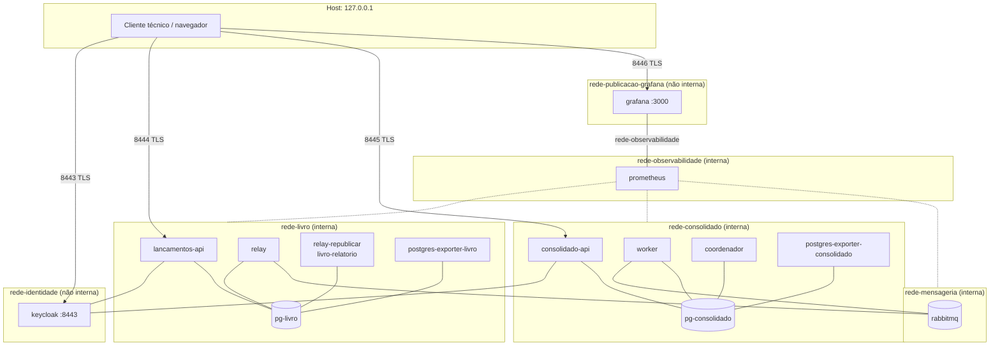

# 05 - Implantação local

Aqui explico como implantei a solução na máquina local: um único Docker
Compose (INFRA 1.5; 001 TD-001), redes por fronteira, portas, volumes,
identidades técnicas, TLS, segredos e health checks. A fonte da verdade é o
[`infra/compose.yaml`](../../infra/compose.yaml). Os passos de execução para o
avaliador estão no README da raiz (task 006-T7). Índice: [README](README.md).

## Plataforma

| Item | Valor | Origem |
|------|-------|--------|
| Sistema | Linux com Docker Engine e Docker Compose v2. Não testei macOS nem Windows: sem garantia | INFRA 1.1, 1.4, 1.5; decisão minha (001/Q-001) |
| Orquestração | Um arquivo Compose, projeto `cashflow`, um nó | 001 TD-001 |
| Python | 3.12, workspace uv; imagens de serviço construídas a partir do repositório | INFRA 1.3; decisão minha (ST-Q-001) |
| Fora do escopo | Kubernetes, alta disponibilidade, cluster de PostgreSQL e RabbitMQ, balanceador, API Gateway, nuvem | INFRA - Fora do escopo |

## Redes

Texto alternativo: criei seis redes. A rede do livro liga a API de lançamentos, o
relay, os comandos do lado do livro, o banco do livro, o exporter do livro e
o Prometheus. A rede do consolidado liga o worker, a API do consolidado, o
coordenador, o banco do consolidado, o exporter do consolidado e o
Prometheus. A rede da mensageria liga o RabbitMQ, o relay, o worker e o
Prometheus. A rede de identidade liga o Keycloak e as duas APIs e é a única,
além da do Grafana, alcançável pelo host. A rede de observabilidade liga
Prometheus e Grafana. A rede de publicação do Grafana só contém o Grafana. O
host chega apenas a Keycloak, APIs e Grafana, pelas portas publicadas em
127.0.0.1. Nenhuma rede liga o lado do consolidado ao banco do livro.

| Rede | Interna | Membros | Por quê | Origem |
|------|---------|---------|---------|--------|
| `rede-livro` | sim, sem IPv4 na ponte do host | `pg-livro`, `lancamentos-api`, `relay`, `relay-republicar`, `livro-relatorio`, `livro-migracao`, `postgres-exporter-livro`, `prometheus` | Isola o banco do livro | 001 TD-002; INFRA 6.1, 6.7 |
| `rede-consolidado` | sim, sem IPv4 na ponte do host | `pg-consolidado`, `worker`, `consolidado-api`, `coordenador`, `consolidado-migracao`, `postgres-exporter-consolidado`, `prometheus` | Isola o banco do consolidado | 001 TD-002 |
| `rede-mensageria` | sim, sem IPv4 na ponte do host | `rabbitmq`, `relay`, `worker`, `prometheus` | RabbitMQ não exposto a clientes externos | INFRA 6.3 |
| `rede-identidade` | não | `keycloak`, `lancamentos-api`, `consolidado-api` | O Docker não publica porta de contêiner ligado só a redes internas | 001 TD-002 |
| `rede-observabilidade` | sim, sem IPv4 na ponte do host | `prometheus`, `grafana` | Host não alcança o Prometheus | 007 TD-007 |
| `rede-publicacao-grafana` | não | `grafana` | Única forma de publicar o Grafana em loopback sem dar a ele rota até Keycloak e APIs | 007 TD-007 |

"Interna" significa `internal: true` com
`com.docker.network.bridge.inhibit_ipv4`: sem saída para fora e sem rota do
host até os contêineres, nem pelo IP interno. Fiz o `/metrics` das APIs
escutar só no alias da API na rede interna do seu lado
(`lancamentos-api-metricas`, `consolidado-api-metricas`), porque as APIs
também estão na `rede-identidade`, que o host alcança (007 TD-007).

O Prometheus é o único contêiner que pus nas redes dos dois lados. Aceitei
essa exceção porque ele só lê `/metrics` e não abre caminho entre os
componentes do consolidado e o `pg-livro` (`007/design.md` §3).

## Portas publicadas

Publiquei somente em `127.0.0.1` e somente com TLS (INFRA 5.7, 6.5, 6.6).
Deixei cada porta do host trocável por variável em `infra/.env`, para o caso
de estar ocupada na máquina do avaliador.

| Serviço | Host | Contêiner | Variável |
|---------|------|-----------|----------|
| `keycloak` | `127.0.0.1:8443` | 8443 | `KEYCLOAK_PORTA_HOST` |
| `lancamentos-api` | `127.0.0.1:8444` | 8443 | `LANCAMENTOS_API_PORTA_HOST` |
| `consolidado-api` | `127.0.0.1:8445` | 8443 | `CONSOLIDADO_API_PORTA_HOST` |
| `grafana` | `127.0.0.1:8446` | 3000 | `GRAFANA_PORTA_HOST` |

Não publiquei porta para bancos, RabbitMQ (inclusive a interface de
administração), Prometheus, exporters, `/metrics` e health de relay e worker,
coordenador e comandos. Confirmo em
[`tests/infra/test_isolamento.py`](../../tests/infra/test_isolamento.py) que o
host não conecta a essas portas.

## Serviços por ciclo de vida

| Ciclo | Serviços | Como roda |
|-------|----------|-----------|
| Contínuo (`up`) | `pg-livro`, `pg-consolidado`, `rabbitmq`, `keycloak`, `lancamentos-api`, `relay`, `worker`, `consolidado-api`, `prometheus`, `grafana`, `postgres-exporter-livro`, `postgres-exporter-consolidado` | `restart: unless-stopped`, com health check |
| Perfil `migracao` | `livro-migracao`, `consolidado-migracao` | `docker compose -f infra/compose.yaml run --rm --build <serviço>`, uma vez antes de subir os serviços que dependem do esquema |
| Perfil `operacao` | `relay-republicar`, `livro-relatorio`, `coordenador` | `docker compose -f infra/compose.yaml run --rm <serviço> <argumentos>`, pelo operador |

Usei perfis para manter os comandos de execução única fora do `up`, que só
aguarda contêineres de longa duração. Sem o esquema aplicado, as APIs, o
relay e o worker sobem mas ficam não prontos.

Dependências de subida (`depends_on` com `service_healthy`): as APIs esperam
o seu banco e o Keycloak; relay e worker esperam o seu banco e o RabbitMQ; os
exporters esperam o seu banco; o Grafana espera o Prometheus.

## Volumes

Dei um volume a cada componente com estado (INFRA 7.1). Recriar contêineres
sem `-v` preserva os dados; verifico isso com o script
[`infra/verificar-ambiente.sh`](../../infra/verificar-ambiente.sh)
`persistencia` grava marcadores, recria os contêineres e confere.

| Volume | Serviço | Conteúdo |
|--------|---------|----------|
| `vol-pg-livro` | `pg-livro` | Livro, outbox e papéis |
| `vol-pg-consolidado` | `pg-consolidado` | Projeção, gerações, quarentena e papéis |
| `vol-rabbitmq` | `rabbitmq` | Filas e mensagens persistentes; hostname fixo para o nó manter o diretório de dados |
| `vol-keycloak` | `keycloak` | Realm importado, segredos dos clientes e chaves de assinatura |
| `vol-prometheus` | `prometheus` | Séries temporais |
| `vol-grafana` | `grafana` | Banco interno do Grafana |

Os scripts de inicialização (papéis do PostgreSQL, importação do realm) só
rodam na criação do volume. Escrevi os scripts de papéis idempotentes, para
que possam ser reaplicados a um volume existente sem apagar dados
(007 TD-007).

## Identidades técnicas

Dei uma credencial a cada papel em cada sistema, com privilégio mínimo
(INFRA 5.11; 001 TD-003), para que o vazamento de uma credencial só exponha
a função dela. Senhas e segredos vêm de `infra/.env`.

| Papel | PostgreSQL | RabbitMQ | Keycloak |
|-------|------------|----------|----------|
| API de lançamentos | `livro_api`: SELECT e INSERT em `lancamento`; INSERT na outbox; atualiza o contador | n/a | valida JWT |
| Migrações do livro | `livro_migracao` (DDL) | n/a | n/a |
| Relay | `livro_relay`: lê a outbox e atualiza só os metadados de publicação | `relay`: escrita só em `cashflow.lancamentos`, sem configurar nem ler | n/a |
| Replay e relatório do livro | `livro_replay`: reabre eventos; lê posição, tipo, valor e data | n/a | n/a |
| Worker | `consolidado_worker` | `worker`: leitura só de `consolidado.lancamentos` | n/a |
| API do consolidado | `consolidado_api`, somente leitura | n/a | valida JWT |
| Migrações do consolidado | `consolidado_migracao` (DDL) | n/a | n/a |
| Coordenador | `consolidado_operacao`: gerações, barreira, ponteiro; não escreve na projeção | n/a | n/a |
| Exporters | `livro_monitoramento`, `consolidado_monitoramento` (`pg_monitor`) | n/a | n/a |
| Administração do Keycloak | n/a | n/a | `admin-cashflow` no realm `master` |
| Clientes técnicos | n/a | n/a | `cliente-lancamentos` (`lancamentos:registrar`); `cliente-consultas` (`consolidado:consultar`, `lancamentos:consultar`) |

Crio os papéis em
[`infra/postgres/livro/10-papeis.sh`](../../infra/postgres/livro/10-papeis.sh)
e [`infra/postgres/consolidado/10-papeis.sh`](../../infra/postgres/consolidado/10-papeis.sh);
e concedo os privilégios nas tabelas pelas migrações. Declarei usuários e
permissões do RabbitMQ em
[`definicoes.modelo.json`](../../infra/rabbitmq/definicoes.modelo.json);
realm em [`realm-cashflow.json`](../../infra/keycloak/realm-cashflow.json),
versionado sem segredos (001 TD-005). Testes que escrevi para isso:
[`test_papeis_banco.py`](../../tests/infra/test_papeis_banco.py),
[`test_rabbitmq_permissoes.py`](../../tests/infra/test_rabbitmq_permissoes.py),
[`test_keycloak.py`](../../tests/infra/test_keycloak.py).

## TLS

- Gero a AC local com OpenSSL por
  [`infra/tls/gerar-certificados.sh`](../../infra/tls/gerar-certificados.sh)
  (001 TD-004), com certificados de servidor para `lancamentos-api`,
  `consolidado-api`, `keycloak` e `grafana`. Nomes alternativos de cada
  certificado: o nome do serviço (DNS na rede interna), `localhost` e
  `127.0.0.1`, para que o acesso pelo host e pela rede interna validem.
- A saída fica em `infra/tls/gerados/`, que o Git ignora; a chave privada da
  AC e as chaves de servidor nunca são versionadas (INFRA 5.9). Conferi no
  histórico inteiro que nenhuma delas foi commitada.
- Rodo o Keycloak em modo produção, só com HTTPS. As APIs validam o
  certificado do Keycloak contra a AC local ao buscar o JWKS. O cliente
  técnico precisa confiar na AC (`ac-cashflow.crt`).
- Teste: [`test_certificados.py`](../../tests/infra/test_certificados.py).

## Segredos

- Deixei o modelo [`.env.example`](../../.env.example) só com nomes e valores
  vazios; a cópia preenchida fica em `infra/.env`, que o Git ignora (INFRA
  5.9, 5.10).
- Configurei o compose para recusar a subida com variável obrigatória vazia
  (`${VAR:?...}`), para que nenhum serviço suba sem senha.
- Teste de ausência de segredos versionados:
  [`test_segredos.py`](../../tests/infra/test_segredos.py).

## Health checks

Pus live e ready em todos os componentes (INFRA 8.4, 8.5). Defini "pronto"
como dependências utilizáveis, não só processo vivo, porque um processo vivo
sem banco não atende ninguém.

| Serviço | Pronto quando |
|---------|---------------|
| `pg-livro`, `pg-consolidado` | `pg_isready` |
| `rabbitmq` | listeners aceitando conexão (`check_port_connectivity`) |
| `keycloak` | `/health/ready` com 200 na interface de gerenciamento, só no loopback do contêiner |
| `lancamentos-api` | `/health/ready` por TLS: banco do livro e JWKS |
| `relay` | `/health/ready`: outbox legível e RabbitMQ conectado |
| `worker` | `/health/ready`: controle da projeção legível e RabbitMQ conectado |
| `consolidado-api` | `/health/ready` por TLS: geração ativa legível e JWKS |
| `prometheus` | `/-/ready` |
| `grafana` | `/api/health` por TLS |

Não pus health check nos exporters; quando param, o Prometheus mostra o alvo
com `up = 0` (`007/design.md` §8). O `pg_isready` dos bancos roda sem `-h`,
pelo socket, e pode dar saudável durante a inicialização do volume; deixei
isso registrado nas
[lacunas conhecidas](../evolucoes.md#lacunas-conhecidas-da-implementação).

## Versões fixadas

Fixei a versão estável vigente na data da implementação, conferida na página
oficial, com fonte e data em comentário no compose (decisão minha, ST-Q-009;
001 TD-007), para que o ambiente seja reprodutível. Fiz a conferência em
2026-11-06.

| Imagem | Tag |
|--------|-----|
| PostgreSQL | `postgres:18.6-alpine3.24` |
| RabbitMQ | `rabbitmq:4.4.0-management-alpine` |
| Keycloak | `quay.io/keycloak/keycloak:26.8.2` |
| Prometheus | `prom/prometheus:v3.16.0` |
| Grafana OSS | `grafana/grafana:13.3.0` |
| postgres_exporter | `quay.io/prometheuscommunity/postgres-exporter:v0.20.1` |

Nas imagens dos serviços Python, declarei as versões das imagens base nos
próprios `Dockerfile` (`services/*/Dockerfile`).
