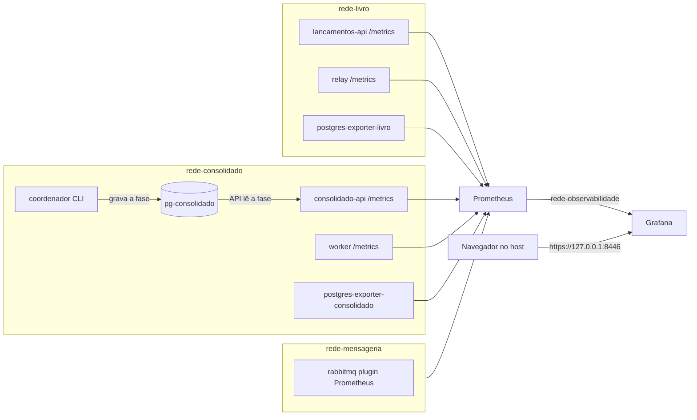

# Observabilidade

Monitoramento da solução, diferencial de DES ("monitoramento e
observabilidade") e requisitos de INFRA §8. Implementação na spec 007
(observabilidade com métricas), aprovada por Eduardo em 2026-11-05, com as
emendas de 2026-11-06. Conteúdo conferido contra o código, o
[`infra/compose.yaml`](../infra/compose.yaml), os alvos de coleta, as regras
de alerta e o painel versionado. As specs ficam em `.ai/sdd/specs/`, pasta
local que não é versionada (decisão 006 D-006).

Fontes:

- DES = [`Desafio_Arquiteto_Soluções.md`](../Desafio_Arquiteto_Solu%C3%A7%C3%B5es.md)
- INFRA = [`Requisitos_de_Infraestrutura.md`](../Requisitos_de_Infraestrutura.md)

Legenda de origem, a mesma de [`requisitos.md`](requisitos.md): "Fonte" =
DES ou INFRA; "Eduardo" = decisão do autor com data; "Proposta" = não consta
nas fontes e foi aprovada junto com a spec; `[NVI]` = não verificado.

Decisões: [ADR-012](adr/ADR-012-prometheus-grafana.md) (Prometheus e
Grafana), [ADR-015](adr/ADR-015-catalogo-fechado-de-metricas.md) (catálogo
fechado de métricas) e
[ADR-016](adr/ADR-016-isolamento-de-rede-da-observabilidade.md) (isolamento
de rede da observabilidade).

## Visão geral

| Peça | Papel | Onde |
|------|-------|------|
| `packages/observabilidade` | Catálogo fechado de métricas de aplicação e endpoint `/metrics` de cada processo Python (007 TD-002, TD-003) | [`catalogo.py`](../packages/observabilidade/src/observabilidade/catalogo.py), [`metricas.py`](../packages/observabilidade/src/observabilidade/metricas.py) |
| APIs, relay e worker | Expõem `/metrics` na porta interna 9464 | `infra/compose.yaml`, variável `METRICAS_PORTA` |
| Plugin Prometheus do RabbitMQ | Mensagens por fila, reentregas e disco livre, porta 15692 | [`infra/rabbitmq/enabled_plugins`](../infra/rabbitmq/enabled_plugins) |
| `postgres-exporter-livro`, `postgres-exporter-consolidado` | Métricas de cada PostgreSQL, inclusive o tamanho do banco, com papel `*_monitoramento` (`pg_monitor`) | `infra/compose.yaml` |
| Prometheus 3.16.0 | Coleta a cada 15 s, avalia as regras de alerta; sem porta publicada | [`prometheus.yml`](../infra/observabilidade/prometheus.yml), [`regras.yml`](../infra/observabilidade/regras.yml) |
| Grafana OSS 13.3.0 | Painel "CashFlow" e fonte de dados provisionados na subida; publicado só em `127.0.0.1:8446` com TLS | [`infra/observabilidade/grafana/`](../infra/observabilidade/grafana/dashboards/cashflow.json) |

Texto alternativo: as APIs de lançamentos e do consolidado, o relay e o
worker expõem `/metrics`; o RabbitMQ expõe o plugin Prometheus; cada banco
PostgreSQL tem um exporter. O Prometheus coleta todos esses alvos pelas redes
internas do livro, do consolidado e da mensageria. O Grafana lê o Prometheus
pela rede interna de observabilidade e é o único componente da
observabilidade publicado no host, em loopback com TLS. O coordenador roda
como comando de linha e não é alvo: grava a fase da reconstrução no banco do
consolidado, e a API do consolidado a publica como métrica.

Exposição (007 FR-003; INFRA 6.1, 6.6): Prometheus, exporters, plugin do
RabbitMQ e `/metrics` não têm porta publicada no host. As redes de dados e a
`rede-observabilidade` são internas e sem IPv4 na ponte do host. O `/metrics`
de cada API escuta só no alias da API na rede interna do seu lado
(`METRICAS_ENDERECO`), porque as APIs também estão na `rede-identidade`, que o
host alcança (007 TD-007; [ADR-016](adr/ADR-016-isolamento-de-rede-da-observabilidade.md)).

## Métricas de INFRA 8.3

As 12 métricas exigidas por INFRA 8.3, com o nome do mapa de 007 design §4
(nomes: Proposta), o componente que a origina (o `job` do Prometheus) e o
painel do Grafana que a exibe, no formato "seção > painel". Medidor = valor
instantâneo; contador = só cresce e volta a zero quando o processo reinicia.

| # | Item de INFRA 8.3 | Métrica (tipo, rótulos) | Componente de origem (`job`) | Painel Grafana |
|---|-------------------|-------------------------|------------------------------|----------------|
| 1 | Backlog da outbox | `cashflow_outbox_pendentes` (medidor) | relay (`relay`) | Livro e outbox > Backlog da outbox |
| 2 | Idade do evento mais antigo | `cashflow_outbox_idade_mais_antigo_segundos` (medidor) | relay (`relay`) | Livro e outbox > Idade do evento mais antigo, com a linha do limite do alerta |
| 3 | Mensagens prontas e não confirmadas | `rabbitmq_detailed_queue_messages_ready` e `rabbitmq_detailed_queue_messages_unacked` (por `queue`) | RabbitMQ, plugin, família `queue_coarse_metrics` (`rabbitmq-filas`) | Mensageria > Mensagens prontas e não confirmadas por fila |
| 4 | Reentregas | `cashflow_worker_reentregas_total` (contador) | worker (`worker`) | Mensageria > Reentregas, ao lado de `rabbitmq_global_messages_redelivered_total` do broker |
| 5 | Quarentena | `cashflow_quarentena_total` (contador) | worker (`worker`) | Consolidado > Quarentena (total) e Quarentena por intervalo |
| 6 | Pools de conexão | `cashflow_pool_conexoes` (medidor; `componente`, `estado` = `total`, `disponivel`, `em_uso`, `aguardando`) | API de lançamentos (`lancamentos-api`), API do consolidado (`consolidado-api`), worker (`worker`) | Recursos > Pools de conexão |
| 7 | Espaço em disco | `pg_database_size_bytes` (por `datname`); `rabbitmq_disk_space_available_bytes` e `rabbitmq_disk_space_available_limit_bytes` | exporters (`postgres-livro`, `postgres-consolidado`); RabbitMQ, plugin (`rabbitmq`) | Recursos > Tamanho dos bancos; Recursos > Disco livre do RabbitMQ |
| 8 | Geração ativa | `cashflow_geracao_ativa` (medidor) | API do consolidado (`consolidado-api`), atualizada a cada leitura do banco | Consolidado > Geração ativa |
| 9 | Fase da reconstrução | `cashflow_reconstrucao_fase` (medidor, código da fase) | coordenador grava em `fase_reconstrucao`; a API do consolidado lê a cada 10 s (`FASE_INTERVALO_SEGUNDOS`) e publica (`consolidado-api`) | Reconstrução > Fase da reconstrução |
| 10 | Checkpoint | `cashflow_checkpoint_posicao` (medidor; `geracao`) | worker (`worker`) | Reconstrução > Checkpoint por geração |
| 11 | Lacunas | `cashflow_lacunas` (medidor; `geracao`) | worker (`worker`) | Reconstrução > Lacunas por geração |
| 12 | Falhas de JWT e JWKS | `cashflow_jwt_falhas_total` (contador; `motivo`) e `cashflow_jwks_falhas_total` (contador) | as duas APIs, pelo pacote `packages/seguranca` (`lancamentos-api`, `consolidado-api`) | Segurança > Falhas de JWT por motivo; Segurança > Falhas de JWKS |

Diferenças em relação ao mapa de 007 design §4, verificadas no código e em
[`tests/observabilidade/test_cobertura.py`](../tests/observabilidade/test_cobertura.py):

- **Pools de conexão:** o mapa lista APIs, relay, worker e coordenador. O
  coordenador roda como comando de linha, sem `/metrics` (o próprio design
  §4 já o diz). O relay não registra `cashflow_pool_conexoes` (003-T5 não o
  implementou e 003 design §12 não o pede). Pendência aberta para a revisão
  da spec 007, não resolvida aqui.
- **Mensagens prontas e não confirmadas e espaço em disco:** vêm de métricas
  nativas do plugin do RabbitMQ e do exporter do PostgreSQL, sem nome
  `cashflow_*`, como o mapa prevê.

### Valores dos rótulos e códigos

Fase da reconstrução (`cashflow_reconstrucao_fase`), da fase da linha mais
recente de `fase_reconstrucao`
([`fase.py`](../services/consolidado/adaptadores/http/fase.py)); o painel
mostra o nome:

| Código | Fase |
|--------|------|
| 0 | nenhuma reconstrução registrada |
| 1 | `construindo` |
| 2 | `barreira` |
| 3 | `concluida` |
| 4 | `revertida` |
| 5 | `cancelada` |
| 6 | `descartada` |
| -1 | nome de fase desconhecido |

`motivo` de `cashflow_jwt_falhas_total`, lista fechada
([`erros.py`](../packages/seguranca/src/seguranca/erros.py)), com todas as
séries criadas em zero na subida: `ausente`, `malformado`, `algoritmo`,
`kid_desconhecido`, `assinatura`, `expirado`, `nao_vigente`, `emissor`,
`audiencia`, `escopo`, `jwks_indisponivel`.

`geracao` de checkpoint e lacunas: identificador numérico da geração da
projeção (005), não dado de cliente.

## Métricas do projeto fora de INFRA 8.3

Decisão do projeto, não exigência das fontes: emendas 007 TD-005 e TD-006,
de Eduardo, em 2026-11-06, registradas em
[ADR-015](adr/ADR-015-catalogo-fechado-de-metricas.md).

| Métrica (tipo, rótulos) | Componente de origem (`job`) | Painel Grafana | Por quê |
|-------------------------|------------------------------|----------------|---------|
| `cashflow_http_requisicoes_total` (contador; `componente` = `lancamentos-api` ou `consolidado-api`, `status` = código HTTP) | as duas APIs (`lancamentos-api`, `consolidado-api`), uma vez por resposta, inclusive 401, 403 e 422 gerados antes da rota | Livro e outbox > Requisições da API de lançamentos por status; Consolidado > Requisições da API do consolidado por status; Segurança > Respostas 401 e 403 | Torna a taxa de erro, base da meta de até 5% de perda do consolidado (DES), observável fora do teste de carga (007 TD-005) |
| `cashflow_relay_falhas_publicacao_total` (contador; `resultado` = `devolvido`, `recusado`, `sem_confirmacao`, `falha`) | relay (`relay`); as quatro séries começam em zero | Livro e outbox > Falhas de publicação do relay | Distingue fila ausente, recusa do broker, falta de confirmação e queda de conexão, causa que backlog e idade da outbox não mostram (007 TD-006) |

Métricas nativas também usadas no painel: `up` de cada alvo (Alvos de coleta >
Alvos no ar) e `rabbitmq_global_messages_redelivered_total` (Mensageria >
Reentregas). Nenhuma outra métrica `cashflow_*` existe: o pacote recusa, na
subida, métrica fora do catálogo.

## Rótulos sem dados sensíveis

INFRA 8.2 e 007 FR-004: nenhum valor financeiro, token, segredo ou
identificador de cliente ou de lançamento em nome ou rótulo de métrica.

- **Catálogo fechado (007 TD-003):** cada métrica tem a lista exata de rótulos
  permitidos em `ROTULOS_PERMITIDOS`; registrar métrica ou rótulo fora dela é
  erro na subida do processo.
- **Defesa adicional:** rótulo cujo nome sugira dado sensível (`cliente`,
  `lancamento`, `valor`, `saldo`, `token`, `segredo`, `senha`) é recusado
  mesmo que alguém o acrescente à lista.
- **Verificação no ambiente:**
  [`test_cobertura.py`](../tests/observabilidade/test_cobertura.py) lê do
  Prometheus todas as séries `cashflow_*` e confere que só têm os rótulos do
  catálogo e que nenhum valor de rótulo tem forma de UUID ou de valor
  monetário.

## Alertas

Regras avaliadas pelo Prometheus e exibidas no painel (seção Alertas) e na
página de alertas do Grafana; sem notificação externa, porque nenhuma fonte
define canal de envio (007 FR-006, TD-004; regras: Proposta). Limites em
[`regras.yml`](../infra/observabilidade/regras.yml).

| Alerta | Condição | Limite | Severidade |
|--------|----------|--------|------------|
| `CashFlowOutboxEventoAntigo` | `cashflow_outbox_idade_mais_antigo_segundos` acima do limite | 300 s (provisório: acima do teto de espera do relay, 60 s, somado ao lease, 30 s) | `aviso` |
| `CashFlowQuarentena` | soma de `cashflow_quarentena_total` acima do limite | 0 | `critico` |
| `CashFlowLacunas` | `cashflow_lacunas` de uma geração acima do limite por mais de 1 minuto | 0 | `aviso` |

Cada limite é uma série `cashflow:limite_*`, também desenhada no painel.
Para mudar um limite: editar o número em `regras.yml` e recarregar a
configuração sem perder dados, com
`docker compose -f infra/compose.yaml kill -s SIGHUP prometheus`.

Limitação: `cashflow_quarentena_total` conta desde a última subida do worker.
O registro permanente da quarentena é a tabela `quarentena` do consolidado.

## Painel Grafana

Painel único "CashFlow" (uid `cashflow`), versionado em
[`cashflow.json`](../infra/observabilidade/grafana/dashboards/cashflow.json) e
carregado pelo provisionamento na subida, com a fonte de dados Prometheus
(007 FR-002; design 007 §7).

| Seção | Painéis |
|-------|---------|
| Alvos de coleta | Alvos no ar (`up`) |
| Alertas | Alertas disparados |
| Livro e outbox | Backlog da outbox; Idade do evento mais antigo; Falhas de publicação do relay; Requisições da API de lançamentos por status |
| Mensageria | Mensagens prontas e não confirmadas por fila; Reentregas |
| Consolidado | Geração ativa; Quarentena (total); Quarentena por intervalo; Requisições da API do consolidado por status |
| Reconstrução | Fase da reconstrução; Checkpoint por geração; Lacunas por geração |
| Segurança | Falhas de JWT por motivo; Falhas de JWKS; Respostas 401 e 403 |
| Recursos | Pools de conexão; Tamanho dos bancos; Disco livre do RabbitMQ |

Acesso, com o ambiente no ar: `https://localhost:8446` (porta trocável por
`GRAFANA_PORTA_HOST`), usuário `admin-cashflow` e senha `GRAFANA_SENHA_ADMIN`
de `infra/.env`. O navegador precisa confiar na AC local
(`infra/tls/gerados/ac/ac-cashflow.crt`). Sem cadastro aberto, sem acesso
anônimo e sem telemetria para fora.

## Logs estruturados

INFRA 8.1 e 8.2. Cada componente escreve uma linha JSON por evento, com
redação aplicada pelo próprio módulo de logs, sem depender de quem escreve a
mensagem lembrar a regra
([lançamentos](../services/lancamentos/adaptadores/http/logs.py),
[relay](../services/relay/adaptadores/logs.py),
[consolidado e worker](../services/consolidado/adaptadores/logs.py),
[coordenador](../services/coordenador/adaptadores/logs.py)).

- **Correlação:** nas APIs, cada linha leva `correlation_id`. O cliente pode
  enviar `X-Correlation-ID` (até 64 caracteres entre letras, dígitos, `.`,
  `_` e `-`); fora desse formato, ou ausente, a API gera um UUID. No worker,
  a identificação é o `evento_id`.
- **Redação:** campos com nome sensível (por exemplo `valor`, `saldo`,
  `descricao`, `payload`, `token`, `senha`, `segredo`; na API de lançamentos,
  também a chave de idempotência) saem como `[REDIGIDO]`; padrões de JWT e de
  `Bearer`, credenciais em URL (`usuario:senha@`) e pares como
  `password=valor` são apagados do texto; exceção sai só com o tipo e a
  pilha, sem a mensagem, que pode repetir dados gravados.
- **Conteúdo:** relay, worker e coordenador registram só identificação
  (`evento_id`, `posicao`, geração, fase), contagens e tipos de erro, nunca o
  conteúdo financeiro.

Não há rastreamento distribuído (tracing) nesta entrega: fora do escopo do
projeto (handoff das specs, "Out of Scope").

## Health checks

Live e ready em APIs, bancos, RabbitMQ, Keycloak, relay, worker, Prometheus e
Grafana; "pronto" significa dependências utilizáveis, não só processo vivo
(INFRA 8.4, 8.5; 007 FR-005). Tabela completa em
[05 - Implantação local](arquitetura/05-implantacao-local.md#health-checks).
Os exporters não têm health check no compose; parados, aparecem com `up = 0`
na seção Alvos de coleta.

## Verificação

Testes automatizados, executados com o ambiente no ar (`docker compose -f
infra/compose.yaml up -d --wait`):

| Teste | O que garante |
|-------|---------------|
| [`tests/observabilidade/test_alvos.py`](../tests/observabilidade/test_alvos.py) | Todos os alvos com `up = 1`; exporters com o papel de monitoramento; Prometheus só em redes internas; host não alcança `/metrics` nem Prometheus; Grafana só em loopback e só com TLS |
| [`tests/observabilidade/test_cobertura.py`](../tests/observabilidade/test_cobertura.py) | Dados no Prometheus para as 12 métricas de INFRA 8.3, cada uma do componente de origem; dados para as duas métricas fora de INFRA 8.3; rótulos sem dado sensível |
| [`tests/observabilidade/test_painel.py`](../tests/observabilidade/test_painel.py) | Painel com as seções do design; cada métrica de INFRA 8.3 num gráfico; painel carregado pelo provisionamento; cada consulta do painel devolve dados pela API do Grafana |
| [`tests/observabilidade/test_regras.py`](../tests/observabilidade/test_regras.py) | Regras válidas no `promtool`; cada alerta dispara acima do limite e não dispara com a solução saudável; quarentena injetada num projeto compose à parte dispara o alerta |

O teste de carga do consolidado rodou com a coleta ativa e cumpriu a meta
(007 NFR-001); números em
[`testes/carga-consolidado.md`](testes/carga-consolidado.md).

`[NVI]` A conferência visual do painel durante o teste de carga ficou
pendente manual de Eduardo (atividade 9.1); a verificação automatizada
consulta cada painel pela API do Grafana fora da carga.
